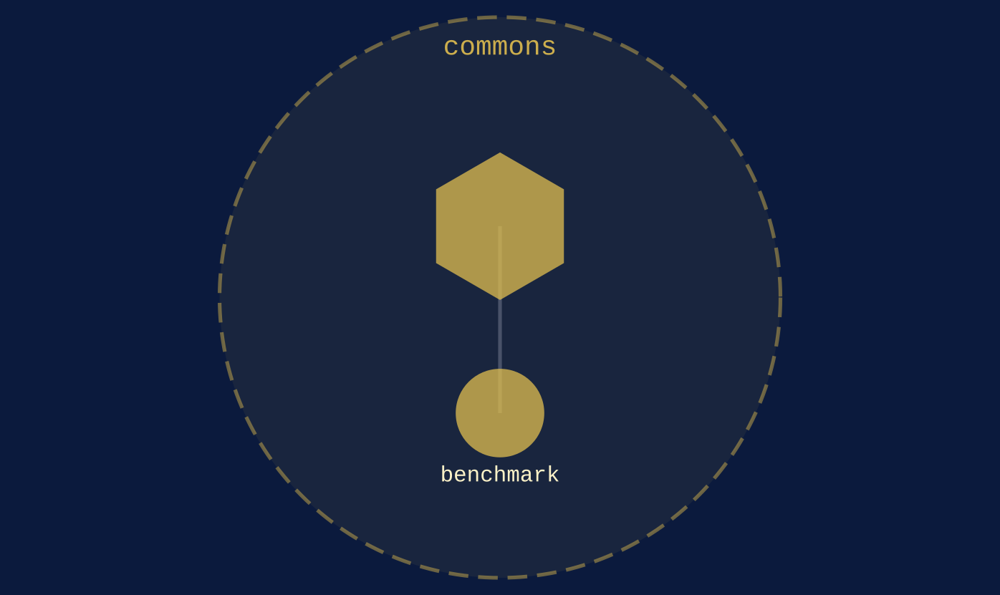

commons
{ .qm-eyebrow }

# the public. { .qm-family-title .qm-f-commons }

Drives the public — open information a community reads and adds to: maps, records, public data.
{ .qm-lede }

## Who is in it

[benchmark](../projects/benchmark.md){ .qm-card-link }

v0.0.0

A place to keep track of benches

Every member here is at `v0.0.0`, so no member has records to start from. Reading the code is the entry point.

<section class="qm-section" markdown>

what it looks like
{ .qm-eyebrow }

## Showcase

the graphs codecarto draws
{ .qm-eyebrow }

### Showgraph

<figure class="qm-shot" markdown>

<figcaption><strong>Where it sits.</strong> Its members, the families within it and the seams between them.</figcaption>

</figure>

Drawn by codecartographer at `0c64e94` from the corpus at `3b94882`, on 2026-10-26. [The show document](../show/family/commons/show.json) holds each graph as drawn.
{ .qm-caption }

</section>

Generated by `uv run qm cookbook docs/families --site --write` from `families.json`, the inventory, `ci/showcase.yaml` and the show documents `uv run codecarto show export` writes into `docs/show/`. The families are decided in the [family record](https://github.com/quaternionmedia/qm/blob/main/records/DRAFT-a-family-is-bordered-by-what-it-drives.md); edit the roster, the record or the showcase, not this page.
{ .qm-caption }
