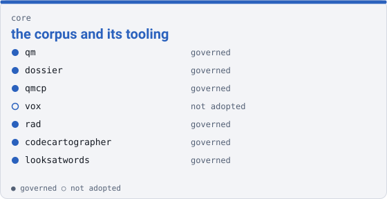

core

# the corpus and its tooling { .qm-family-title .qm-f-core }

Drives the corpus and its tooling — governance, the archive, the deltas, the maps, the language data.

{ .qm-picture }

## Who is in it

| member | governed | also in |
|---|---|---|
| `qm` | yes | — |
| `dossier` | yes | — |
| `qmcp` | yes | — |
| `vox` | no | — |
| `rad` | yes | — |
| `codecartographer` | yes | — |
| `looksatwords` | yes | — |

## Starting here

Start in `qm`: it is governed, so its records and its `AGENTS.md` say how work arrives there.

Generated by `uv run qm cookbook docs/families --site --write` from `families.json`. The families are decided in the [family record](https://github.com/quaternionmedia/qm/blob/main/records/DRAFT-a-family-is-bordered-by-what-it-drives.md); edit the roster or the record, not this page.
{ .qm-caption }
