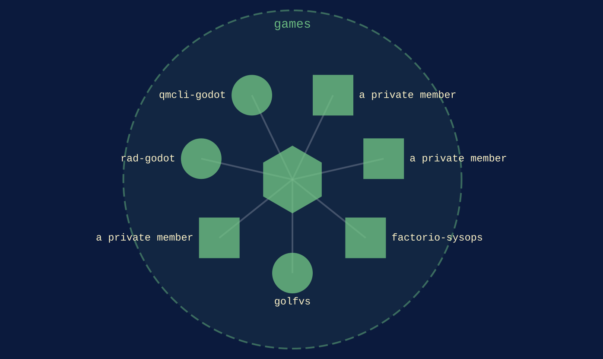

games
{ .qm-eyebrow }

# play. { .qm-family-title .qm-f-games }

Drives play — a game somebody plays: its rules, its world, its loop, and the server it is played on.
{ .qm-lede }

## Who is in it

[factorio-sysops](../projects/factorio-sysops.md){ .qm-card-link }

v0.0.1

Factorio mod: IT Infrastructure addon (sensors, servers, dashboards, incidents, technical debt) -- monitor and automate your factory's IT layer

[golfvs](../projects/golfvs.md){ .qm-card-link }

v0.0.0

Golf is the only sport where nobody is trying to stop you. golfVs fixes that. Arcade physics golf with asymmetric defence, built in Godot.

[rad-godot](../projects/rad-godot.md){ .qm-card-link }

v0.0.0

rad, the radial menu, as a Godot addon: the contract's vectors replayed in GDScript.

[qmcli-godot](../projects/index.md#qmcli-godot){ .qm-card-link }

not on the host yet

3 private repositories are counted here and not named.

Start in [`factorio-sysops`](../projects/factorio-sysops.md): its records and its `AGENTS.md` say how work arrives there.

<section class="qm-section" markdown>

what it looks like
{ .qm-eyebrow }

## Showcase

the graphs codecarto draws
{ .qm-eyebrow }

### Showgraph

<figure class="qm-shot" markdown>

<figcaption><strong>Where it sits.</strong> Its members, the families within it and the seams between them.</figcaption>

</figure>

Drawn by codecartographer at `0c64e94` from the corpus at `3b94882`, on 2026-10-26. [The show document](../show/family/games/show.json) holds each graph as drawn.
{ .qm-caption }

</section>

Generated by `uv run qm cookbook docs/families --site --write` from `families.json`, the inventory, `ci/showcase.yaml` and the show documents `uv run codecarto show export` writes into `docs/show/`. The families are decided in the [family record](https://github.com/quaternionmedia/qm/blob/main/records/DRAFT-a-family-is-bordered-by-what-it-drives.md); edit the roster, the record or the showcase, not this page.
{ .qm-caption }
