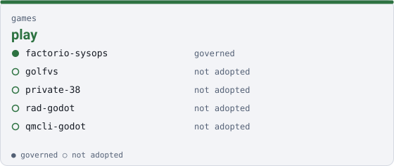

games

# play { .qm-family-title .qm-f-games }

Drives play — a game somebody plays: its rules, its world, its loop, and the server it is played on.

{ .qm-picture }

## Who is in it

| member | governed | also in |
|---|---|---|
| `factorio-sysops` | yes | — |
| `golfvs` | no | — |
| `private-38` | no | — |
| `rad-godot` | no | — |
| `qmcli-godot` | no | — |

## Starting here

Start in `factorio-sysops`: it is governed, so its records and its `AGENTS.md` say how work arrives there.

Generated by `uv run qm cookbook docs/families --site --write` from `families.json`. The families are decided in the [family record](https://github.com/quaternionmedia/qm/blob/main/records/DRAFT-a-family-is-bordered-by-what-it-drives.md); edit the roster or the record, not this page.
{ .qm-caption }
