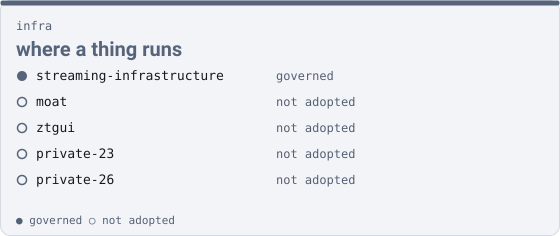

infra

# where a thing runs { .qm-family-title .qm-f-infra }

Drives where a thing runs, and how it is reached — ingress, identity, storage, DNS, observability, the network path.

{ .qm-picture }

## Who is in it

[moat](projects/moat.md){ .qm-card-link }

not adopted

simple reverse proxy with Traefik

[ztgui](projects/ztgui.md){ .qm-card-link }

not adopted

Zeroteir Gui

`streaming-infrastructure` is in the roster with no repository on the host yet, so it has no page.

2 private repositories are counted here and not named.

## Starting here

Start in `streaming-infrastructure`: it is governed, so its records and its `AGENTS.md` say how work arrives there.

Generated by `uv run qm cookbook docs/families --site --write` from `families.json`, the inventory and `ci/showcase.yaml`. The families are decided in the [family record](https://github.com/quaternionmedia/qm/blob/main/records/DRAFT-a-family-is-bordered-by-what-it-drives.md); edit the roster, the record or the showcase, not this page.
{ .qm-caption }
