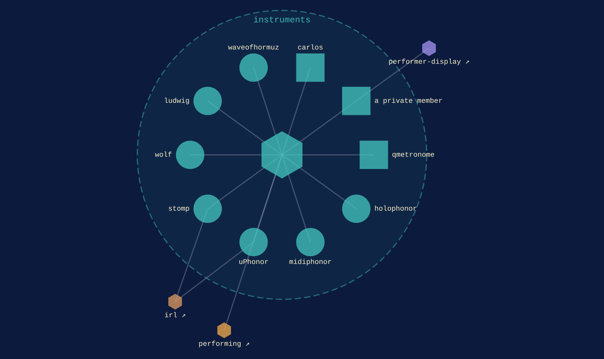

instruments · within [performing](performing.md)
{ .qm-eyebrow }

# the sound. { .qm-family-title .qm-f-instruments }

Drives the sound — looping, synthesis, tempo, remote control surfaces.
{ .qm-lede }

<figure class="qm-hero-shot" markdown>

<figcaption><strong>carlos.</strong> Two drum voices wired to a Novation Launchpad X and a Squarp Hapax.</figcaption>

</figure>

## Who is in it

{ .qm-thumb loading=lazy }

[carlos](../projects/carlos.md){ .qm-card-link }

v0.0.1

Browser workspace for sketching hardware rigs from real gear, patched on the face its sockets are on

{ .qm-thumb loading=lazy }

[qmetronome](../projects/qmetronome.md){ .qm-card-link }

v0.0.3

Metronome and tempo visualizer for Android 13+: tap tempo, set queues, MIDI clock sync, and the Nothing Phone Glyph Matrix

[holophonor](../projects/holophonor.md){ .qm-card-link }

v0.0.0

Live looping, unlimited!

[midiphonor](../projects/midiphonor.md){ .qm-card-link }

v0.0.0

A Holophonor implementation, using Tone.js

[uPhonor](../projects/uPhonor.md){ .qm-card-link }

v0.0.0 · also in [`irl`](irl.md)

Micro-Holophonor

[stomp](../projects/stomp.md){ .qm-card-link }

v0.0.0 · also in [`irl`](irl.md)

a midi foot controller for Arduino / Teensy

[wolf](../projects/wolf.md){ .qm-card-link }

v0.0.0

remote midi controller

[ludwig](../projects/ludwig.md){ .qm-card-link }

v0.0.0

remote mixing

{ .qm-thumb loading=lazy }

[waveofhormuz](../projects/waveofhormuz.md){ .qm-card-link }

v0.0.0

VCV Rack 2 strait-shaping square wave oscillator — conflict timeline as a default waveform

1 private repository is counted here and not named.

Start in [`carlos`](../projects/carlos.md): its records and its `AGENTS.md` say how work arrives there.

<section class="qm-section" markdown>

what it looks like
{ .qm-eyebrow }

## Showcase

the graphs codecarto draws
{ .qm-eyebrow }

### Showgraph

<figure class="qm-shot" markdown>

<figcaption><strong>Where it sits.</strong> Its members, the families within it and the seams between them.</figcaption>

</figure>

Drawn by codecartographer at `0c64e94` from the corpus at `3b94882`, on 2026-10-26. [The show document](../show/family/instruments/show.json) holds each graph as drawn.
{ .qm-caption }

</section>

Generated by `uv run qm cookbook docs/families --site --write` from `families.json`, the inventory, `ci/showcase.yaml` and the show documents `uv run codecarto show export` writes into `docs/show/`. The families are decided in the [family record](https://github.com/quaternionmedia/qm/blob/main/records/DRAFT-a-family-is-bordered-by-what-it-drives.md); edit the roster, the record or the showcase, not this page.
{ .qm-caption }
