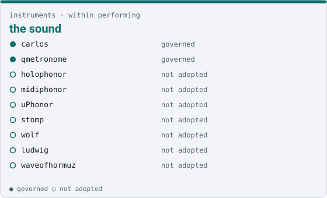

instruments · within performing

# the sound { .qm-family-title .qm-f-instruments }

Drives the sound — looping, synthesis, tempo, remote control surfaces.

{ .qm-picture }

Within [`performing`](performing.md): everyone here is in `performing` as well, without claiming it.

## Who is in it

| member | governed | also in |
|---|---|---|
| `carlos` | yes | — |
| `qmetronome` | yes | — |
| `holophonor` | no | — |
| `midiphonor` | no | — |
| `uPhonor` | no | [`irl`](irl.md) |
| `stomp` | no | [`irl`](irl.md) |
| `wolf` | no | — |
| `ludwig` | no | — |
| `waveofhormuz` | no | — |

## Starting here

Start in `carlos`: it is governed, so its records and its `AGENTS.md` say how work arrives there.

Generated by `uv run qm cookbook docs/families --site --write` from `families.json`. The families are decided in the [family record](https://github.com/quaternionmedia/qm/blob/main/records/DRAFT-a-family-is-bordered-by-what-it-drives.md); edit the roster or the record, not this page.
{ .qm-caption }
