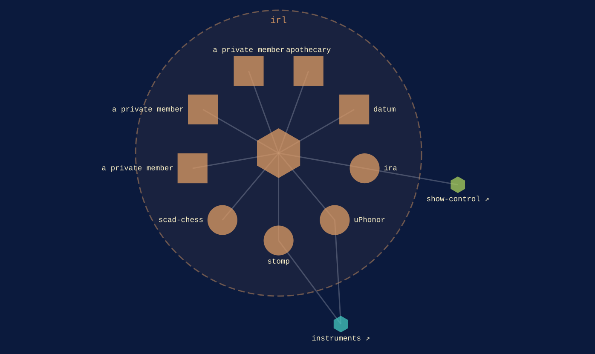

irl
{ .qm-eyebrow }

# matter. { .qm-family-title .qm-f-irl }

Drives matter — a thing somebody builds, holds or installs: parts, boards, enclosures, and the firmware that makes one work.
{ .qm-lede }

<figure class="qm-hero-shot" markdown>

<figcaption><strong>scad-chess.</strong> The chess set, modelled in OpenSCAD.</figcaption>

</figure>

## Who is in it

[apothecary](../projects/apothecary.md){ .qm-card-link }

v0.0.2

OpenSCAD generation toolkit and curated printable parts, composed from Python

[datum](../projects/datum.md){ .qm-card-link }

v0.0.1

A physical switch for devices that lost one: dry contacts in, versioned JSON events out over MQTT

[ira](../projects/ira.md){ .qm-card-link }

v0.0.0 · also in [`show-control`](show-control.md)

LED controller, designed for live theater

[uPhonor](../projects/uPhonor.md){ .qm-card-link }

v0.0.0 · also in [`instruments`](instruments.md)

Micro-Holophonor

[stomp](../projects/stomp.md){ .qm-card-link }

v0.0.0 · also in [`instruments`](instruments.md)

a midi foot controller for Arduino / Teensy

{ .qm-thumb loading=lazy }

[scad-chess](../projects/scad-chess.md){ .qm-card-link }

v0.0.0

Chess set, designed in openSCAD

3 private repositories are counted here and not named.

Start in [`apothecary`](../projects/apothecary.md): its records and its `AGENTS.md` say how work arrives there.

<section class="qm-section" markdown>

what it looks like
{ .qm-eyebrow }

## Showcase

the graphs codecarto draws
{ .qm-eyebrow }

### Showgraph

<figure class="qm-shot" markdown>

<figcaption><strong>Where it sits.</strong> Its members, the families within it and the seams between them.</figcaption>

</figure>

Drawn by codecartographer at `99602ff` from the corpus at `e1d1306`, on 2026-10-27. [The show document](../show/family/irl/show.json) holds each graph as drawn.
{ .qm-caption }

</section>

Generated by `uv run qm cookbook docs/families --site --write` from `families.json`, the inventory, `ci/showcase.yaml` and the show documents `uv run codecarto show export` writes into `docs/show/`. The families are decided in the [family record](https://github.com/quaternionmedia/qm/blob/main/records/DRAFT-a-family-is-bordered-by-what-it-drives.md); edit the roster, the record or the showcase, not this page.
{ .qm-caption }
