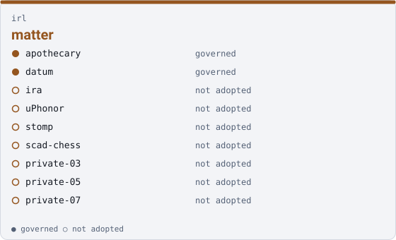

irl

# matter { .qm-family-title .qm-f-irl }

Drives matter — a thing somebody builds, holds or installs: parts, boards, enclosures, and the firmware that makes one work.

{ .qm-picture }

## Who is in it

| member | governed | also in |
|---|---|---|
| `apothecary` | yes | — |
| `datum` | yes | — |
| `ira` | no | [`show-control`](show-control.md) |
| `uPhonor` | no | [`instruments`](instruments.md) |
| `stomp` | no | [`instruments`](instruments.md) |
| `scad-chess` | no | — |
| `private-03` | no | — |
| `private-05` | no | — |
| `private-07` | no | — |

## Starting here

Start in `apothecary`: it is governed, so its records and its `AGENTS.md` say how work arrives there.

Generated by `uv run qm cookbook docs/families --site --write` from `families.json`. The families are decided in the [family record](https://github.com/quaternionmedia/qm/blob/main/records/DRAFT-a-family-is-bordered-by-what-it-drives.md); edit the roster or the record, not this page.
{ .qm-caption }
