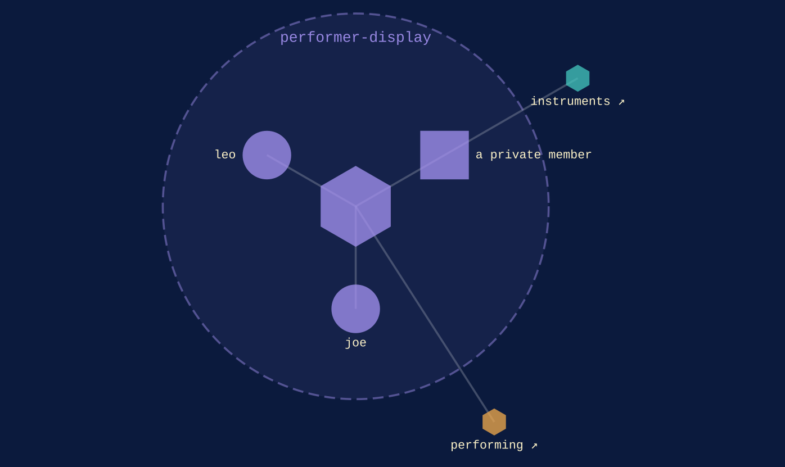
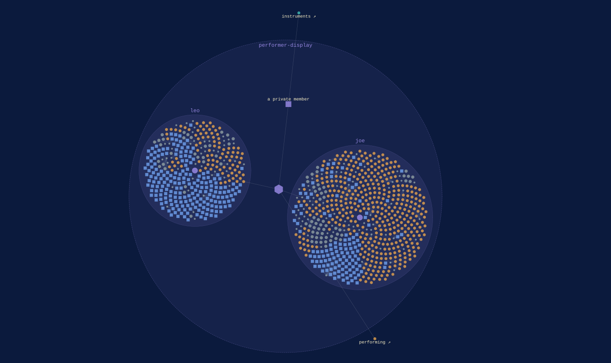

performer-display · within [performing](performing.md)
{ .qm-eyebrow }

# the performer. { .qm-family-title .qm-f-performer-display }

Drives the performer — what a player reads while playing.
{ .qm-lede }

## Who is in it

[loopwall](../projects/loopwall.md){ .qm-card-link }

v0.0.1 · also in [`instruments`](instruments.md)

Name and paths live in ci/workspace-private.yaml, which is not committed, for the same reason as private-32 and private-33 above.

[joe](../projects/joe.md){ .qm-card-link }

v0.0.0

Realtime sheet music visualization

[leo](../projects/leo.md){ .qm-card-link }

v0.0.0

Web pdf viewer, annotator, collaborator

Start in [`loopwall`](../projects/loopwall.md): its records and its `AGENTS.md` say how work arrives there.

<section class="qm-section" markdown>

what it looks like
{ .qm-eyebrow }

## Showcase

the graphs codecarto draws
{ .qm-eyebrow }

### Showgraph

<figure class="qm-shot" id="showgraph-estate" markdown>

<figcaption><strong>Where it sits.</strong> Its members, the families within it and the seams between them.</figcaption>

</figure>

<figure class="qm-shot" id="showgraph-code" markdown>

<figcaption><strong>Its code.</strong> Each of its projects with its code in it.</figcaption>

</figure>

Drawn by codecartographer at `92c5a4c` from the corpus at `bb2ed17`, on 2026-10-29. [The show document](../show/family/performer-display/show.json) holds each graph as drawn.
{ .qm-caption }

</section>

Generated by `uv run qm cookbook docs/families --site --write` from `families.json`, the inventory, `ci/showcase.yaml` and the show documents `uv run codecarto show export` writes into `docs/show/`. The families are decided in the [family record](https://github.com/quaternionmedia/qm/blob/main/records/DRAFT-a-family-is-bordered-by-what-it-drives.md); edit the roster, the record or the showcase, not this page.
{ .qm-caption }
