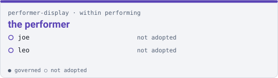

performer-display · within performing

# the performer { .qm-family-title .qm-f-performer-display }

Drives the performer — what a player reads while playing.

{ .qm-picture }

Within [`performing`](performing.md): everyone here is in `performing` as well, without claiming it.

## Who is in it

| member | governed | also in |
|---|---|---|
| `joe` | no | — |
| `leo` | no | — |

## Starting here

No member of this family carries governance yet, so there is no governed entry point. Reading the code is the entry point.

Generated by `uv run qm cookbook docs/families --site --write` from `families.json`. The families are decided in the [family record](https://github.com/quaternionmedia/qm/blob/main/records/DRAFT-a-family-is-bordered-by-what-it-drives.md); edit the roster or the record, not this page.
{ .qm-caption }
