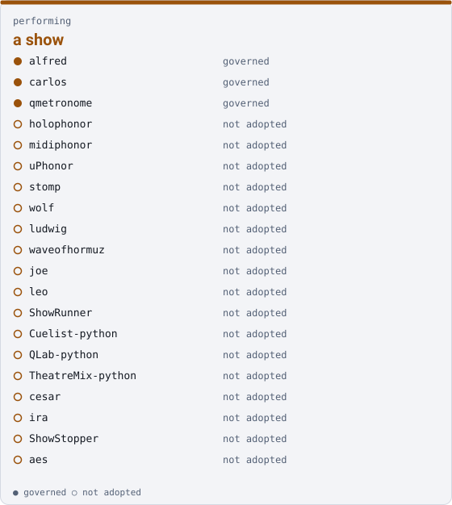

performing

# a show { .qm-family-title .qm-f-performing }

Drives a show — what an audience sees and hears, and the video made before and after it.

{ .qm-picture }

## Who is in it

| member | governed | also in |
|---|---|---|
| `alfred` | yes | — |
| `carlos` | yes | — |
| `qmetronome` | yes | — |
| `holophonor` | no | — |
| `midiphonor` | no | — |
| `uPhonor` | no | [`irl`](irl.md) |
| `stomp` | no | [`irl`](irl.md) |
| `wolf` | no | — |
| `ludwig` | no | — |
| `waveofhormuz` | no | — |
| `joe` | no | — |
| `leo` | no | — |
| `ShowRunner` | no | — |
| `Cuelist-python` | no | — |
| `QLab-python` | no | — |
| `TheatreMix-python` | no | — |
| `cesar` | no | — |
| `ira` | no | [`irl`](irl.md) |
| `ShowStopper` | no | — |
| `aes` | no | — |

## The families within it

| family | drives | members | governed |
|---|---|---|---|
| [`instruments`](instruments.md) | the sound — looping, synthesis, tempo, remote control surfaces | 9 | 2 |
| [`performer-display`](performer-display.md) | the performer — what a player reads while playing | 2 | 0 |
| [`show-control`](show-control.md) | the room — cues, lighting, sound and video playback, audio transport | 8 | 0 |

## Starting here

Start in `alfred`: it is governed, so its records and its `AGENTS.md` say how work arrives there.

Generated by `uv run qm cookbook docs/families --site --write` from `families.json`. The families are decided in the [family record](https://github.com/quaternionmedia/qm/blob/main/records/DRAFT-a-family-is-bordered-by-what-it-drives.md); edit the roster or the record, not this page.
{ .qm-caption }
