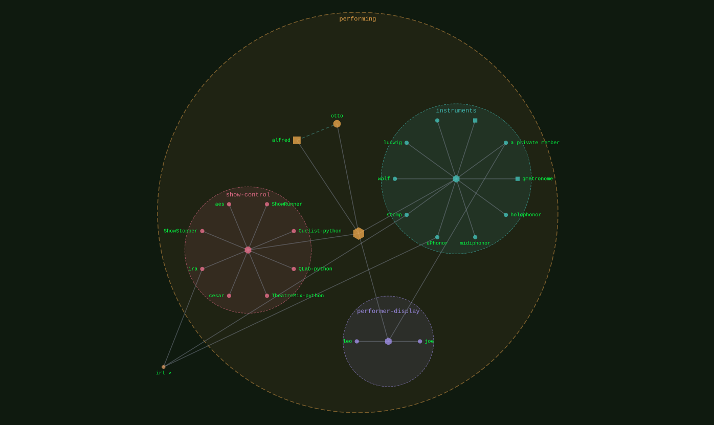

performing
{ .qm-eyebrow }

# a show. { .qm-family-title .qm-f-performing }

Drives a show — what an audience sees and hears, and the video made before and after it.
{ .qm-lede }

<figure class="qm-hero-shot" markdown>

<figcaption><strong>carlos.</strong> Two drum voices wired to a Novation Launchpad X and a Squarp Hapax.</figcaption>

</figure>

## Who is in it

[alfred](../projects/alfred.md){ .qm-card-link }

v0.0.1

serverless video editing

[otto](../projects/otto.md){ .qm-card-link }

v0.0.0

automatic video generation

[the sound](instruments.md){ .qm-card-link }

`instruments` · 10 members

[carlos](../projects/carlos.md), [qmetronome](../projects/qmetronome.md), [holophonor](../projects/holophonor.md), [midiphonor](../projects/midiphonor.md), [uPhonor](../projects/uPhonor.md), [stomp](../projects/stomp.md), [wolf](../projects/wolf.md), [ludwig](../projects/ludwig.md), [waveofhormuz](../projects/waveofhormuz.md), and 1 private

[the performer](performer-display.md){ .qm-card-link }

`performer-display` · 3 members

[joe](../projects/joe.md), [leo](../projects/leo.md), and 1 private

[the room](show-control.md){ .qm-card-link }

`show-control` · 8 members

[ShowRunner](../projects/ShowRunner.md), [Cuelist-python](../projects/Cuelist-python.md), [QLab-python](../projects/QLab-python.md), [TheatreMix-python](../projects/TheatreMix-python.md), [cesar](../projects/cesar.md), [ira](../projects/ira.md), [ShowStopper](../projects/ShowStopper.md), [aes](../projects/aes.md)

Start in [`alfred`](../projects/alfred.md): its records and its `AGENTS.md` say how work arrives there.

<section class="qm-section" markdown>

what it looks like
{ .qm-eyebrow }

## Showcase

the graphs codecarto draws
{ .qm-eyebrow }

### Showgraph

<figure class="qm-shot" id="showgraph-estate" markdown>

<figcaption><strong>Where it sits.</strong> Its members, the families within it and the seams between them.</figcaption>

</figure>

Drawn by codecartographer at `ada6a1b` from the corpus at `6906aee`, on 2026-10-27. [The show document](../show/family/performing/show.json) holds each graph as drawn.
{ .qm-caption }

</section>

Generated by `uv run qm cookbook docs/families --site --write` from `families.json`, the inventory, `ci/showcase.yaml` and the show documents `uv run codecarto show export` writes into `docs/show/`. The families are decided in the [family record](https://github.com/quaternionmedia/qm/blob/main/records/DRAFT-a-family-is-bordered-by-what-it-drives.md); edit the roster, the record or the showcase, not this page.
{ .qm-caption }
