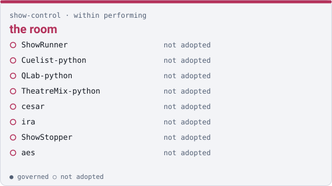

show-control · within performing

# the room { .qm-family-title .qm-f-show-control }

Drives the room — cues, lighting, sound and video playback, audio transport.

{ .qm-picture }

Within [`performing`](performing.md): everyone here is in `performing` as well, without claiming it.

## Who is in it

| member | governed | also in |
|---|---|---|
| `ShowRunner` | no | — |
| `Cuelist-python` | no | — |
| `QLab-python` | no | — |
| `TheatreMix-python` | no | — |
| `cesar` | no | — |
| `ira` | no | [`irl`](irl.md) |
| `ShowStopper` | no | — |
| `aes` | no | — |

## Starting here

No member of this family carries governance yet, so there is no governed entry point. Reading the code is the entry point.

Generated by `uv run qm cookbook docs/families --site --write` from `families.json`. The families are decided in the [family record](https://github.com/quaternionmedia/qm/blob/main/records/DRAFT-a-family-is-bordered-by-what-it-drives.md); edit the roster or the record, not this page.
{ .qm-caption }
