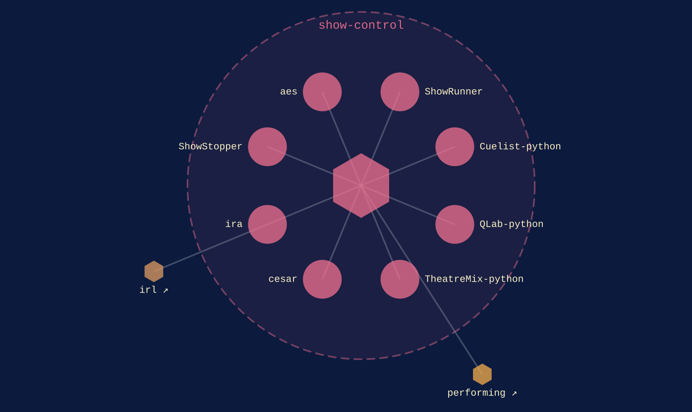

show-control · within [performing](performing.md)
{ .qm-eyebrow }

# the room. { .qm-family-title .qm-f-show-control }

Drives the room — cues, lighting, sound and video playback, audio transport.
{ .qm-lede }

## Who is in it

[ShowRunner](../projects/ShowRunner.md){ .qm-card-link }

v0.0.0

Show control for live performances

[Cuelist-python](../projects/Cuelist-python.md){ .qm-card-link }

v0.0.0

Python helpers for Cuelist (thecuelist.com) and plugin for ShowRunner

[QLab-python](../projects/QLab-python.md){ .qm-card-link }

v0.0.0

QLab interface for Python

[TheatreMix-python](../projects/TheatreMix-python.md){ .qm-card-link }

v0.0.0

Python components for interacting with TheatreMix

[cesar](../projects/cesar.md){ .qm-card-link }

v0.0.0

A unified lighting / sound / video controller for theatrical applications

[ira](../projects/ira.md){ .qm-card-link }

v0.0.0 · also in [`irl`](irl.md)

LED controller, designed for live theater

[ShowStopper](../projects/ShowStopper.md){ .qm-card-link }

v0.0.0

Stopwatch geared towards tracking need for the performing arts

[aes](../projects/aes.md){ .qm-card-link }

v0.0.0

AES67 scripts

Every member here is at `v0.0.0`, so no member has records to start from. Reading the code is the entry point.

<section class="qm-section" markdown>

what it looks like
{ .qm-eyebrow }

## Showcase

the graphs codecarto draws
{ .qm-eyebrow }

### Showgraph

<figure class="qm-shot" markdown>

<figcaption><strong>Where it sits.</strong> Its members, the families within it and the seams between them.</figcaption>

</figure>

Drawn by codecartographer at `0c64e94` from the corpus at `3b94882`, on 2026-10-26. [The show document](../show/family/show-control/show.json) holds each graph as drawn.
{ .qm-caption }

</section>

Generated by `uv run qm cookbook docs/families --site --write` from `families.json`, the inventory, `ci/showcase.yaml` and the show documents `uv run codecarto show export` writes into `docs/show/`. The families are decided in the [family record](https://github.com/quaternionmedia/qm/blob/main/records/DRAFT-a-family-is-bordered-by-what-it-drives.md); edit the roster, the record or the showcase, not this page.
{ .qm-caption }
