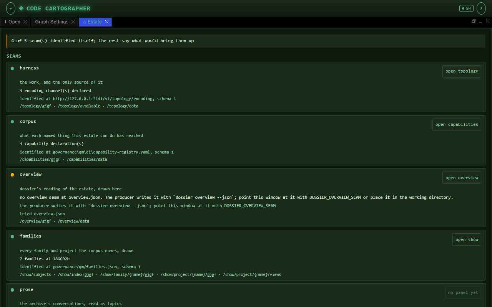
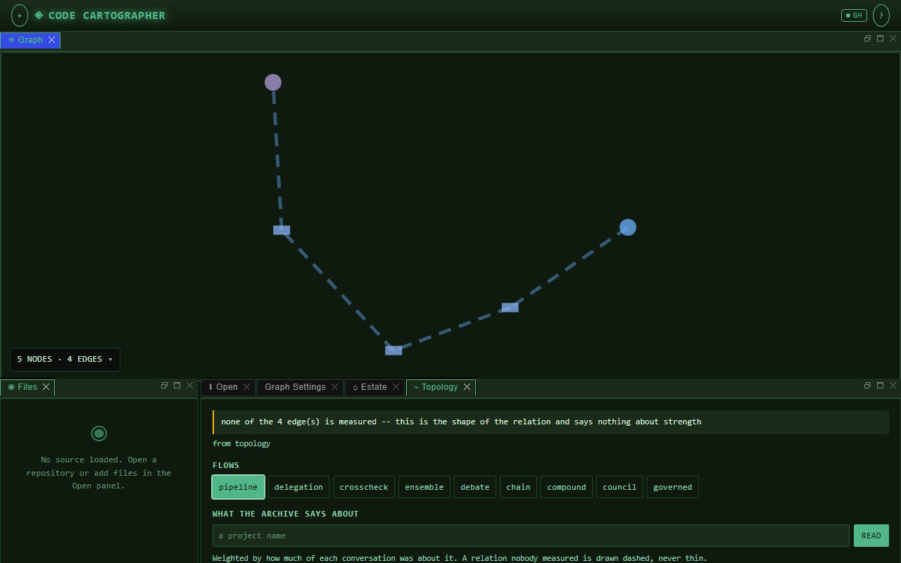
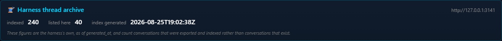
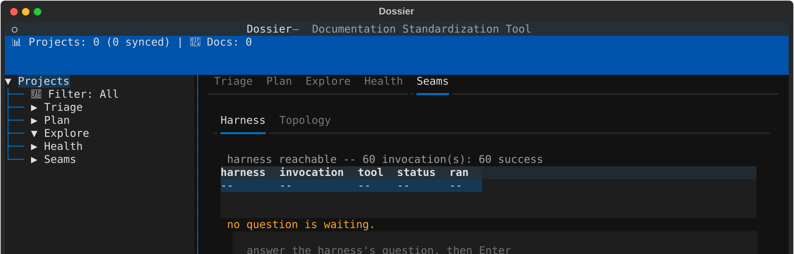

<p class="qm-eyebrow">journeys · every day</p>

# Bring your set up

Say once which repositories this machine runs, start them with one command, and see each one answer: in a table, in the browser and in the terminal. It assumes the repositories are cloned and synced, as in [From a clone to the first demo](clone-to-first-demo.md).
{ .qm-lede }

## 1. Say what this machine runs

A registration names a family, or your own selection of repositories, or both. It is kept in `~/.qm/registered.json`, never in a repository, and each registration replaces the last.

```sh
uv run qm instances register --family core
```

```text
core: family core, registered 2026-10-31T16:14:23Z
  7 repositories: qm, dossier, qmcp, vox, rad, codecartographer, looksatwords
```

For a selection of your own, name each repository: `uv run qm instances register --repo qmcp --repo looksatwords --name bench`. `uv run qm families` lists the families, and `uv run qm instances register` with nothing after it shows what is registered.

## 2. Start it

```sh
uv run qm dashboard --start-registered
```

```text
harness: pid 31260 answers on 3141; output goes to ~/.qm/harness.log
web: pid 30336 answers on 2718; output goes to ~/.qm/web.log
terminal: draws in a terminal; run `cd dossier && uv run dossier dashboard` where you will watch it
prose: pid 13908 answers on 1414; output goes to ~/.qm/prose.log
Registered and not a surface here: qm, rad, vox. `uv run qm instances` says which of them is up
```

It starts the [harness](../ref/glossary.md#harness){ .glossary-term } first, and says a server started only once its port answers. A server that exits first is reported with the end of its log. The terminal front end is never started in the background: it draws in the terminal it runs in, so you run it in step 6.

The dashboard's report follows, with where to look in each surface that is up.

## 3. See that each one answers

```sh
uv run qm instances
```

```text
REGISTERED ON THIS MACHINE  (core: family core)
qm                unjudged  family core      nothing declares it running, and nothing here starts it
dossier           unjudged  family core      a terminal front end, not a server: cd dossier && uv run dossier dashboard
qmcp              up        family core      pid 31648 on 3141, identified
codecartographer  up        family core      pid 33156 on 2718, answering
looksatwords      up        family core      pid 30552 on 1414, answering
```

`up` means a declared server answers on its port. `identified` means the harness also said which process it is; the others answer without saying. `unjudged` is not a problem: `qm` serves nothing, and `dossier` runs in your terminal.

## 4. In the browser: the web front end

Open <http://127.0.0.1:2718/app>. A first visit opens a short tour of loading a repository; close it. Then choose the **Estate** tab in the lower panel. It has one row per [seam](../ref/glossary.md#seam){ .glossary-term } it reads, and says which answered and what would bring the rest up.

<figure class="qm-shot" markdown>



<figcaption><strong>Estate.</strong> Four of five seams answered. The fifth says what writes it and where it looked.</figcaption>

</figure>

Press **open topology** on the harness's row and pick a flow, such as **pipeline**. The graph draws above it. A dashed edge is one nobody measured; it is never drawn as a thin one.

<figure class="qm-shot" markdown>



<figcaption><strong>Topology.</strong> The harness's pipeline, drawn. None of its four edges is measured.</figcaption>

</figure>

## 5. In the browser: the prose reader

Open <http://127.0.0.1:1414/> and choose **Harness** at the foot of the page. The card says how many conversations the harness indexed and when, and the list below it reads them.

<figure class="qm-shot" markdown>



<figcaption><strong>The archive, as the reader sees it.</strong> The harness's own figures, as of when its index was generated.</figcaption>

</figure>

## 6. In the terminal: the terminal front end

In a terminal of its own:

```sh
cd dossier
uv run dossier dashboard
```

Choose **Seams**, then **Harness**. The first line says whether the harness answers and what it has run; below it is the question the harness is waiting on, if any, with a field to answer it.

<figure class="qm-shot" markdown>



<figcaption><strong>Seams, Harness.</strong> The thread archive's list follows below this, and is left out of the picture.</figcaption>

</figure>

The dashboard keeps its own database in the folder it is started from, so start it from `dossier`.

## 7. Both front ends at once

Back in the `qm` clone:

```sh
uv run qm demo --over-http --side-by-side
```

It asks the running servers rather than running the front ends itself, and ends with whether the two windows agree about every box, every arrow, and which edges nobody measured.

## 8. Stop what you started

```sh
uv run qm dashboard --stop harness
uv run qm dashboard --stop web
uv run qm dashboard --stop prose
```

`--stop` ends only a process the dashboard started, by the pid it recorded, and withdraws the run-files that named its port. Quit the terminal front end with `q`.

## When a step does not work

| What you see | What it means | What to do |
|---|---|---|
| `missing` beside a registered repository | it should run here, and nothing declares it running | the command printed beside it, or step 2 |
| `silent` | its process is alive and its port does not answer | it is starting, or hung; read the log step 2 named |
| `stale` | the process is gone and its run-file is not | `uv run qm instances prune --yes` |
| `has no environment yet, so nothing was started` | the repository was never synced | run the command it names, in that repository |
| `something is already listening on 3141` | another process holds the port | `uv run qm instances --port 3141` says whose it is |
| a seam in **Estate** shows a fix | that seam is down | the fix it shows, run in the repository it names |

[Running several repositories](https://github.com/quaternionmedia/qm/blob/main/handbook/running-several-repositories.md) is the procedure behind these steps, for a person and for several sessions sharing one machine.

*What this cannot do:* see a server that declares nothing. A process started by hand on another port is invisible to `qm instances` until `qm instances run` declares it, and the terminal front end opens no port, so nothing on this page can tell whether it is running.
