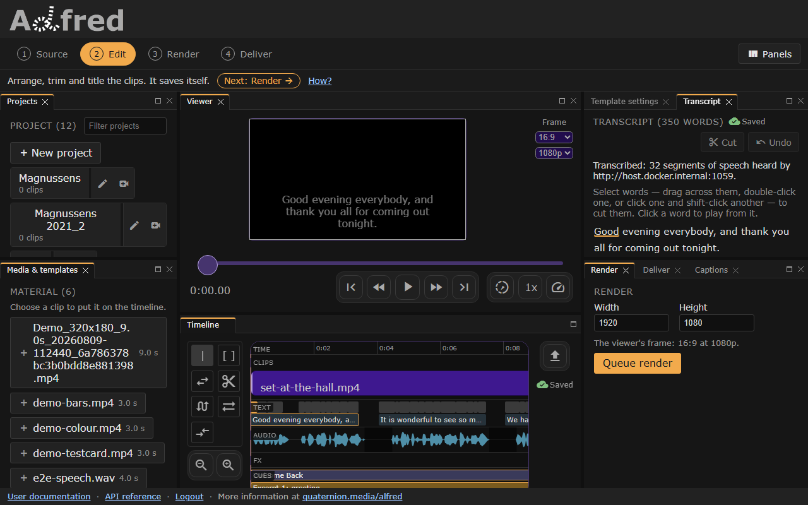
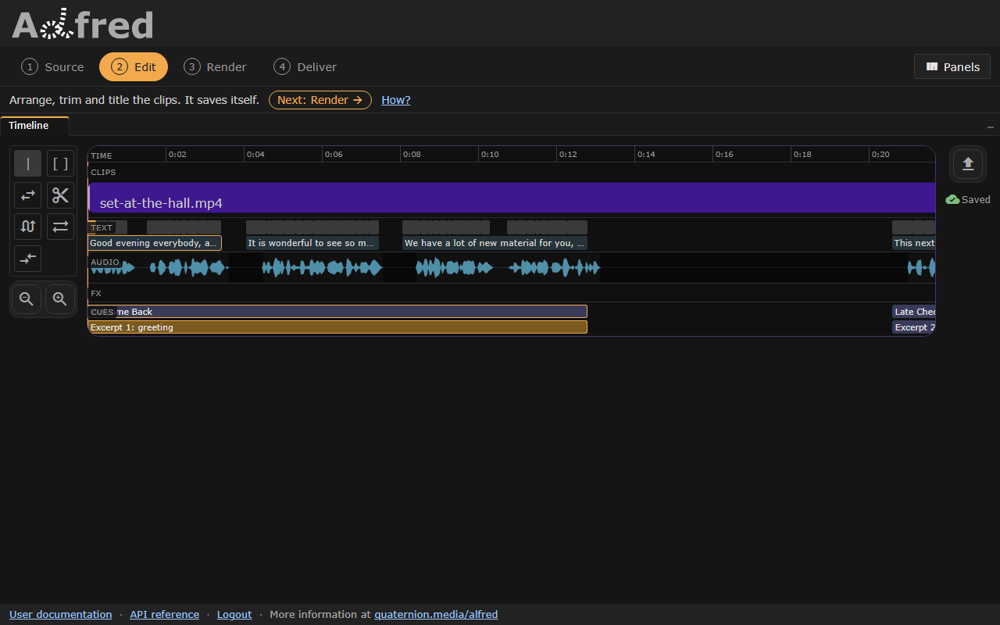
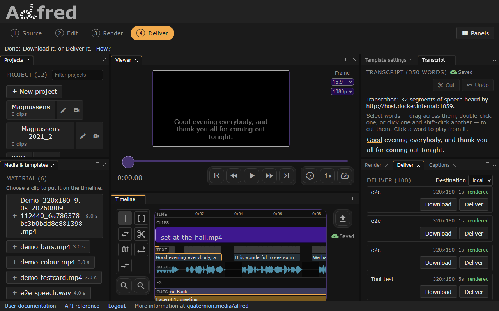

<p class="qm-eyebrow">journeys · by what is said</p>

# Cut a recording by what is said

Put a long recording in the video editor, have the audio engine say what is said in it and when, and edit by the words: delete words to cut the picture, and have the [harness](../ref/glossary.md#harness){ .glossary-term } offer the stretches that stand alone as excerpts, each rendered with its captions once you choose it. Five repositories of the [performing family](../families/performing.md) do it together.
{ .qm-lede }

## Who does what

| Repository | Its part | Where you meet it |
|---|---|---|
| `alfred` | the video editor: the project, its timeline, its captions, its renders | the browser, at the address `./al family up` prints |
| `otto` | the picture: every frame drawn, the timeline's sound mixed, every render made | inside alfred; nothing to start |
| `joe` | the audio engine: hears the sound and says each word and when it was said | started by `./al family up`, beside alfred |
| `vox` | how alfred reaches joe: the contract an audio engine answers | inside alfred; nothing to start |
| `qmcp` | the harness: its `alfred_*` tools drive the editor, and its flows put each decision to you | a terminal, and the queue you answer there or by voice |

alfred's own [docs](https://github.com/quaternionmedia/alfred/tree/main/docs) walk the editor; joe's [media API](https://github.com/quaternionmedia/joe/blob/main/docs/media.md) is what the editor asks it; qmcp's [alfred integration](https://github.com/quaternionmedia/qmcp/blob/main/docs/integrations/alfred.md) is the tools and the flows. This page is the path through all of them.

## What you need

- **Docker Desktop**, running: alfred's stack is its containers.
- **git**, **[uv](https://docs.astral.sh/uv/)** and **ffmpeg** on the `PATH`, for joe.
- alfred and joe cloned side by side, and qmcp beside them for step 5.
- A recording with speech in it, as a video or sound file.

## 1. Start the family

In alfred's checkout:

```sh
./al init
ALFRED_DEV_SKIP_AUTH=1 ./al family up
```

It starts joe on its port, then alfred's stack pointed at it, and prints where each one answers, with the `QMCP_ALFRED_URL` for step 5. `./al family smoke` then checks the path through to joe. Without `ALFRED_DEV_SKIP_AUTH=1`, [register](../ref/glossary.md#register){ .glossary-term } and log in instead.

## 2. Bring the recording

Put the file in the `videos/` directory of alfred's checkout, open the editor, and on **Source** make a project and choose the file under **Material**. It goes on the end of the timeline. A recording of a show, a talk or an interview is one project, however long it runs.

## 3. Hear what is said

On **Edit**, open the **Transcript** tab and press **Transcribe timeline**. alfred has otto mix the timeline's sound and sends it to joe, which answers every word with the moment it was said. The words come back as the transcript and as captions timed to them. On a CPU the first transcription loads joe's speech model, which takes a while; after that, about as long as the speech.

<figure class="qm-shot" markdown>



<figcaption><strong>The transcript.</strong> A paragraph to each stretch the engine heard; a word clicked plays from there.</figcaption>

</figure>

## 4. Cut by deleting words

Select words in the transcript and press **Delete**: the stretch they were said in is cut from the timeline, picture and sound alike, and the captions move with it. This is the editor's own way to edit by what is said, and alfred's docs have its rules. The **Captions** tab corrects a misheard word and chooses how captions are drawn.

The timeline itself shows the same seconds in lanes under the clips: the words and the captions where they are said and shown, the loudness of the sound as the audio engine measured it, each clip's fades, and the cues. A press on any lane puts the playhead there, and a word takes it to its start, so a cut can be placed by what is heard as well as by what is read.

## 5. Offer the stretches that stand alone

The harness reads the transcript the editor holds, cuts it into chapters at the long pauses and into spans at pauses and sentence ends, draws them on the editor's timeline, and asks you about each span. In qmcp's checkout, with Docker running:

```sh
QMCP_ALFRED_URL=http://127.0.0.1:1732 uv run qmcp cookbook serve
uv run qmcp cookbook run alfred-excerpts --project-id <the project's id>
```

The address is the one step 1 printed. Each span arrives as a request on the harness's queue, placing it in the recording and quoting its words; `uv run qmcp human list` lists them, and each is answered with:

```sh
uv run qmcp human respond <request id> approve
```

or by voice through joe's Voice window, which speaks a shorter form of each. Approve the spans worth keeping and reject the rest. With `--label-with local` and `--categories`, the local model titles each chapter and sorts each span into one of your categories first.

<figure class="qm-shot" markdown>



<figcaption><strong>The proposal on the timeline.</strong> The Cues lane draws each chapter and each excerpt where it falls, coloured by where it stands on the queue; the lanes above it are the words and the sound at the same seconds.</figcaption>

</figure>

The editor's **Cues** lane shows the proposal as the flow goes: each chapter, titled when the model titled it, and each excerpt coloured by where it stands, waiting, approved, rejected, rendered or delivered. It reads the cues again every few seconds while any waits, so an answer given in the terminal shows in the editor.

## 6. Review each excerpt

Each approved span is rendered as an excerpt of its own, cut from the timeline with its captions burned in, and put to you again with a link to watch it. On the editor's **Deliver** stage it is the render named for the project and the span, described by its place in the recording and its chapter. A word corrected in the **Captions** tab while the queue waited is in the excerpt.

<figure class="qm-shot" markdown>



<figcaption><strong>An excerpt on Deliver.</strong> Named for the project and the span, described by its place in the recording.</figcaption>

</figure>

## 7. Deliver

Approve an excerpt on the queue to keep it; run the flow with `--deliver True` and the approved ones go to alfred's destination, `local` by default, which is the `deliveries/` directory of alfred's checkout. **Download** on Deliver saves any render through the browser. `./al family down` stops the stack, and the joe it started.

## When a step does not work

| What you see | What it means | What to do |
|---|---|---|
| **Transcribe timeline** is greyed out | no audio engine answers, or no render worker runs to mix the sound | point at it for the reason; `./al family smoke` says which |
| the flow ends `no audio engine` | alfred has no `ALFRED_AUDIO_ENGINE_URL` | start with `./al family up`, which sets it |
| the flow ends `no renderer` | the render worker is not running | `./al family up` starts one with the stack |
| `Nothing was asked: … no stretch of 10 s or more` | every stretch of speech is shorter than the shortest excerpt | `--shortest` with a smaller number, or a longer recording |
| the model titles nothing | Ollama is not running, or has no model | [Use a model with an application](use-a-model-with-an-application.md), step 1 |

*What this cannot do:* choose the excerpts for you. The spans come from pauses and sentence ends, nothing hears the music, and you choose each one; the editor is where a span is refined, by the words. The pictures are taken from a running stack by `uv run qm journey-pictures`, which needs the editor up with a project transcribed.
