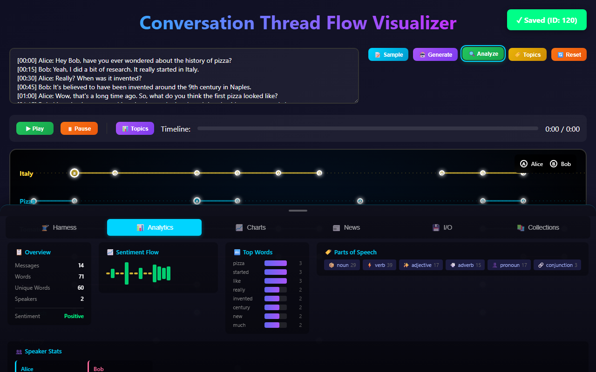
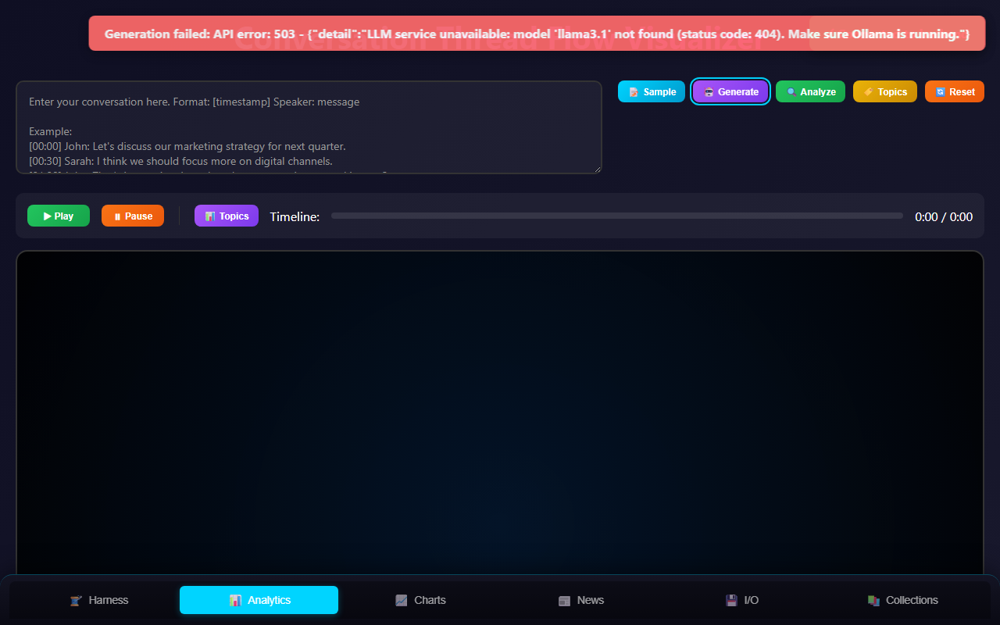

<p class="qm-eyebrow">journeys · with a model</p>

# Use a model with an application

Run a language model on your own machine, start an application with it, and use it from the browser. The prose reader, `looksatwords`, is the application this page walks; the [harness](../ref/glossary.md#harness){ .glossary-term }, `qmcp`, uses the same local model from its command line.
{ .qm-lede }

## Which application takes which model

| Application | What it asks a model for | How you choose the model |
|---|---|---|
| `looksatwords` | **Generate** writes a conversation to read | `LOOKSATWORDS_OLLAMA_MODEL` when it starts; `llama3.1` if unset. It asks Ollama at `http://localhost:11434`. |
| `qmcp`, `--runtime local` | carries out an instruction recorded for a repository | fixed: `qwen2.5-coder:7b` at `http://127.0.0.1:11434`, the model `qmcp localmodel` stands up |
| `qmcp`, `--runtime claude-code` | the same, through the `claude` command line | the `claude` command on your `PATH` |
| `qmcp` flows | a council or ensemble of agents | `--llm-base-url`, `--llm-model` and `--llm-api-key`, for any endpoint that speaks OpenAI's chat completions; [qmcp's flows guide](https://github.com/quaternionmedia/qmcp/blob/main/docs/setup/flows.md) |

The other front ends call no model. The direction the records take is that every model call goes through the harness ([Shrink the black box](https://github.com/quaternionmedia/qm/blob/main/records/DRAFT-shrink-the-black-box.md), [proposed](../ref/glossary.md#proposed){ .glossary-term }); `looksatwords` calls Ollama itself.

## 1. Run a local model

[Ollama](https://ollama.com) serves local models on port 11434. The harness says what this machine needs before you install anything:

```sh
cd qmcp
uv run qmcp localmodel check
uv run qmcp localmodel plan
```

`check` reads the installer, the GPU and the free disk; `plan` prints the commands, and runs none of them. With Ollama running, pull a model and see it listed:

```sh
ollama pull qwen2.5-coder:7b
ollama list
```

## 2. Start the reader with that model

The reader reads its model when it starts, so stop it first if it is running. In the `qm` clone:

```sh
uv run qm dashboard --stop prose
LOOKSATWORDS_OLLAMA_MODEL=qwen2.5-coder:7b uv run qm dashboard --start prose
```

In PowerShell, set the variable on its own line first: `$env:LOOKSATWORDS_OLLAMA_MODEL = 'qwen2.5-coder:7b'`. The dashboard starts the reader with your environment, so the variable reaches it.

## 3. Use it from the browser

Open <http://127.0.0.1:1414/> and press **Generate**. The first answer loads the model, which takes a few seconds; the conversation it writes fills the box. Press **Analyze**, and the reader draws the conversation's topics over time, with its words and speakers below. Analyze also saves the conversation in the reader's own database, and says so.

<figure class="qm-shot" markdown>



<figcaption><strong>Generate, then Analyze.</strong> What the model writes differs on every run.</figcaption>

</figure>

If the reader asks for a model Ollama does not have, **Generate** fails with this:

<figure class="qm-shot" markdown>



<figcaption><strong>A model Ollama does not have.</strong> The message asks whether Ollama is running; Ollama answered, and the model is what is missing.</figcaption>

</figure>

Pull the model it names, or start the reader with one you have, as in step 2.

## 4. The same model, through the harness

The harness can carry out an instruction for a repository with the local model, and remember what it found for the next one. This runs two instructions over a database made for the run, with a script answering each consent, and spends nothing:

```sh
cd qmcp
uv run qmcp cookbook instruct --runtime local
```

```text
  instruction 1: Which file in qmcp says what qmcp is? Answer with the file's path and nothing else.
    read      read_file(README.md)
    said      Done in qmcp. The file that describes what qmcp is is README.md.
  [ok]   ran with the clone passed
  instruction 2: In one sentence, what did that file say qmcp is for?
    carried   instruction 1 and what it found, from qmcp's record
  [ok]   ran in the remembered clone, told what the first found
```

## When a step does not work

| What you see | What it means | What to do |
|---|---|---|
| `model '…' not found` in the reader | Ollama has no model by that name | `ollama pull` it, or step 2 with a model `ollama list` shows |
| the reader still asks for the old model | it read the variable when it started | step 2: stop it, then start it with the variable set |
| `qmcp localmodel check` names no model it serves | Ollama is not running, or has no model | start Ollama, then `ollama list` |
| `the system drive is tight` | Windows unpacks installers on the system drive | `uv run qmcp localmodel plan --models-dir` with a roomier drive |

*What this cannot do:* choose the harness's local model, or give the reader a hosted one. `--runtime local` uses the model qmcp's [local model module](https://github.com/quaternionmedia/qmcp/blob/main/qmcp/localmodel.py) pins, and the reader asks only Ollama. A hosted model reaches this estate through the flows' `--llm-*` options or the `claude` command line.
