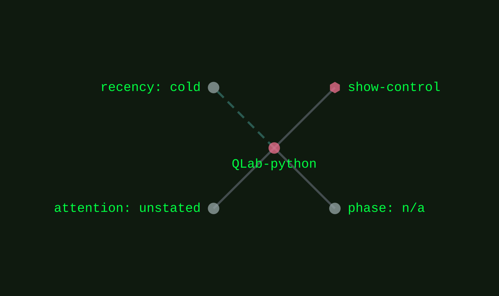
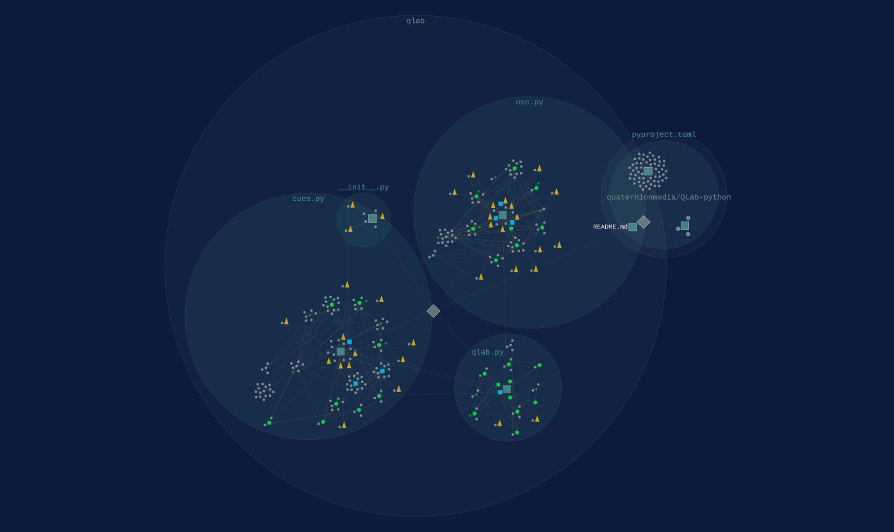

[show-control](../families/show-control.md) · within [performing](../families/performing.md)
{ .qm-eyebrow }

# QLab-python. { .qm-family-title .qm-f-show-control }

QLab interface for Python

[`v0.0.0`](../usage/next-steps.md#the-project-phase-ladder) · Jupyter Notebook
{ .qm-caption }

[QLab-python on GitHub](https://github.com/quaternionmedia/QLab-python){ .md-button .md-button--primary }

No pictures are listed for QLab-python yet. A project's own screenshots are picked in the corpus's `ci/showcase.yaml`.
{ .qm-caption }

<section class="qm-section" markdown>

what it looks like
{ .qm-eyebrow }

## Showcase

the graphs codecarto draws
{ .qm-eyebrow }

### Showgraph

<figure class="qm-shot" id="showgraph-estate" markdown>

<figcaption markdown="span"><strong>Where it sits.</strong> Its families, its phase, its records and the seams it is on. [← otto](otto.md#showgraph-estate) · [every project's estate](codecartographer.md#every-projects-estate) · [qm →](qm.md#showgraph-estate)</figcaption>

</figure>

<figure class="qm-shot" id="showgraph-code" markdown>

<figcaption markdown="span"><strong>Its code.</strong> Its default branch, by directory, file, symbol and member. [← otto](otto.md#showgraph-code) · [every project's code](codecartographer.md#every-projects-code) · [qm →](qm.md#showgraph-code)</figcaption>

</figure>

**Its system:** not drawn. QLab-python declares no system this window reads: no Helm chart, ArgoCD Application, Terraform or Dockerfile.
{ .qm-caption }

Drawn by codecartographer at `92c5a4c` from the corpus at `bb2ed17` and QLab-python's default branch at `ea8028e`, on 2026-10-29. [The show document](../show/project/QLab-python/show.json) holds each graph as drawn.
{ .qm-caption }

</section>

Generated by `uv run qm cookbook docs/families --site --write` from `families.json`, the inventory, `ci/showcase.yaml` and the show documents `uv run codecarto show export` writes into `docs/show/`. The families are decided in the [family record](https://github.com/quaternionmedia/qm/blob/main/records/DRAFT-a-family-is-bordered-by-what-it-drives.md); edit the roster, the record or the showcase, not this page.
{ .qm-caption }
