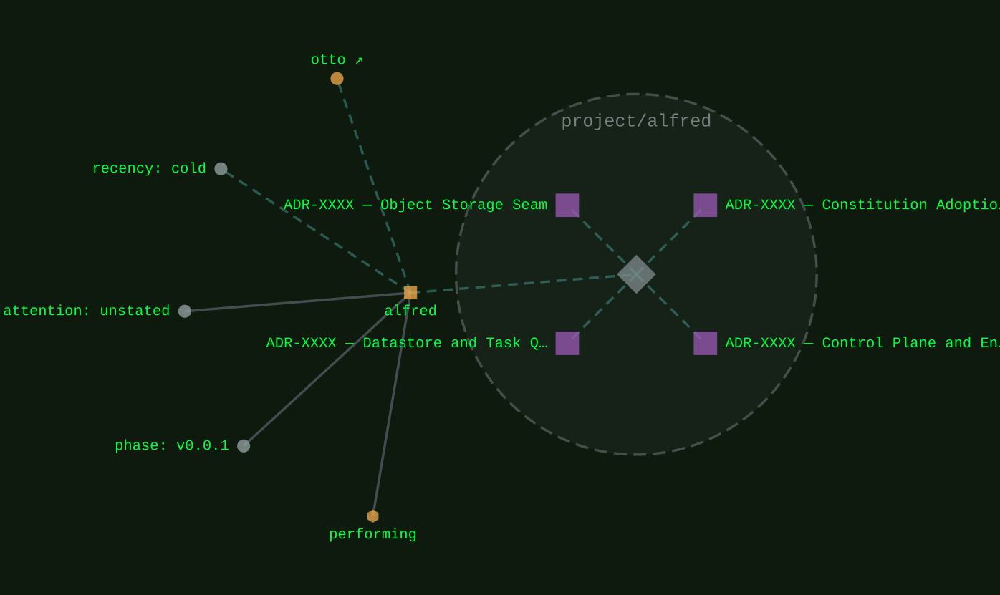
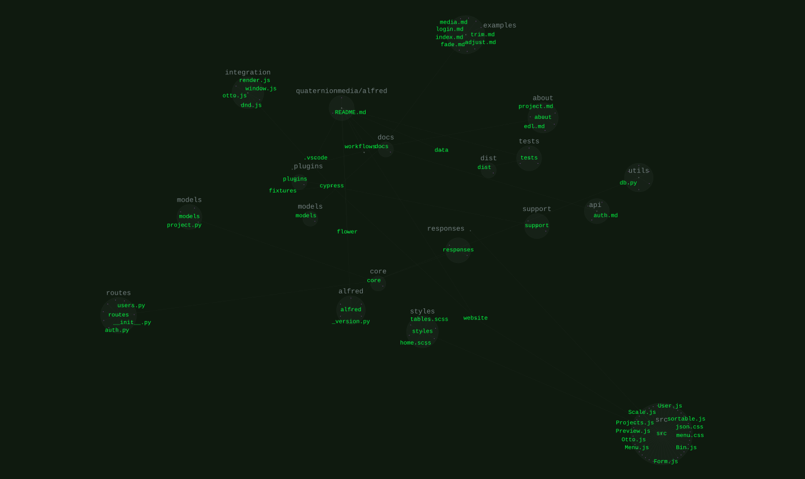

[performing](../families/performing.md)
{ .qm-eyebrow }

# alfred<span class="qm-dot">.</span> { .qm-family-title .qm-f-performing }

A video editor in the browser. Every preview frame and every render is drawn on the server, by a stack its user runs.
{ .qm-lede }

```sh
./al dev
```

Then open `127.0.0.1:8000`.

[`v0.0.1`](../usage/next-steps.md#the-project-phase-ladder) · JavaScript
{ .qm-caption }

[alfred on GitHub](https://github.com/quaternionmedia/alfred){ .md-button .md-button--primary }

*Not on alfred's default branch yet:* The editor at Edit, projects and media on the left, the viewer over the timeline, and the selected title's settings on the right.
{ .qm-caption }

<section class="qm-section" markdown>

four stages, left to right
{ .qm-eyebrow }

## How a video gets made

<div class="grid qm-parts" markdown>

<div class="card qm-f-performing" markdown>

**Source**

<span class="qm-meta">step 1</span>

Choose a project and the media and templates for its timeline, or generate the demo clips.

</div>

<div class="card qm-f-performing" markdown>

**Edit**

<span class="qm-meta">step 2</span>

Arrange, trim and cut the clips on the timeline, and set a title's text, length and colours.

</div>

<div class="card qm-f-performing" markdown>

**Render**

<span class="qm-meta">step 3</span>

Choose the output's size and queue a render, which the server makes.

</div>

<div class="card qm-f-performing" markdown>

**Deliver**

<span class="qm-meta">step 4</span>

Follow the render until it is finished, then download it or send it to a destination.

</div>

</div>

<div class="grid" markdown>

<figure class="qm-shot" markdown>

<figcaption><strong>Render.</strong> <em>Not on alfred's default branch yet.</em> The output's size and Queue render, beside a frame the server drew.</figcaption>

</figure>

<figure class="qm-shot" markdown>

<figcaption><strong>Deliver.</strong> <em>Not on alfred's default branch yet.</em> The rendered demo reel, ready to download or to deliver to a destination.</figcaption>

</figure>

</div>

</section>

<section class="qm-section" markdown>

captions · heard by joe
{ .qm-eyebrow }

## Captions heard by joe, through vox

**Transcribe timeline** sends the project's saved sound to the audio engine, and the captions come back as text to correct; they can also be typed, or imported from a subtitle file. Once **Draw into renders** is ticked, every render carries them. alfred never handles the sound itself: it reaches joe over HTTP through vox, the contract between them, and without an engine the panel says so and Transcribe stays off.

<figure class="qm-shot" markdown>

<figcaption><em>Not on alfred's default branch yet.</em> The Captions tab with Transcribe timeline, and a caption drawn over the colour bars in the viewer.</figcaption>

</figure>

</section>

<section class="qm-section" markdown>

on a phone
{ .qm-eyebrow }

## The same editor, one stage at a time

On a phone the editor shows one stage at a time, above the viewer and the timeline, with the four stages on the rail along its top.

<div class="grid" markdown>

<figure class="qm-shot" markdown>

<figcaption><em>Not on alfred's default branch yet.</em> Edit on a phone, the captions above the viewer and the timeline.</figcaption>

</figure>

<figure class="qm-shot" markdown>

<figcaption><em>Not on alfred's default branch yet.</em> Render on a phone, the output's size and Queue render above the viewer.</figcaption>

</figure>

</div>

</section>

<section class="qm-section" markdown>

the workspace
{ .qm-eyebrow }

## The Panels menu

On a wider screen the editor is a workspace of panels docked with Golden Layout, the shell codecartographer uses. A tab drags to move its panel, the gaps drag to resize, and the arrangement is kept in that browser. The Panels menu brings a closed panel back in its place, and Reset layout restores the default.

<figure class="qm-shot" markdown>

<figcaption><em>Not on alfred's default branch yet.</em> The Panels menu, every panel listed with Template settings closed, and Reset layout.</figcaption>

</figure>

</section>

<section class="qm-section" markdown>

how it is built
{ .qm-eyebrow }

## A control plane, two engines

alfred owns accounts, projects, renders and captions, and decides what happens when. The media work belongs to two engines it vendors side by side: otto draws the picture, and vox carries the sound to an audio engine such as joe. alfred imports no media library; what an engine lacks is a change to that engine, which alfred then pins.

<div class="grid" markdown>

<div class="card" markdown>

**the browser**

<span class="qm-meta">over HTTP, to alfred</span>

A Mithril app in Golden Layout panels. It edits the timeline and shows the frames the server draws.

</div>

<div class="card qm-f-performing" markdown>

**alfred**

<span class="qm-meta">the control plane</span>

FastAPI, MongoDB and a Celery render worker, holding the state and the orchestration.

</div>

<div class="card qm-f-performing" markdown>

[otto](otto.md){ .qm-card-link }

<span class="qm-meta">vendored by alfred, for the picture</span>

Every preview frame and render, and the timeline's sound mixed for it.

</div>

<div class="card qm-f-core" markdown>

[vox](vox.md){ .qm-card-link }

<span class="qm-meta">vendored by alfred, for the sound</span>

The contract and the client for an audio engine.

</div>

<div class="card qm-f-performer-display" markdown>

[joe](joe.md){ .qm-card-link }

<span class="qm-meta">over HTTP from vox, with a schema</span>

The audio engine. It hears the timeline's sound and transcribes it into captions.

</div>

</div>

beside it
{ .qm-eyebrow }

<div class="grid" markdown>

<div class="card qm-f-core" markdown>

[qmcp](qmcp.md){ .qm-card-link }

QM's tool server, which calls alfred's API as tools.

</div>

<div class="card qm-f-core" markdown>

[codecartographer](codecartographer.md){ .qm-card-link }

The Golden Layout panel shell alfred's editor shares.

</div>

<div class="card" markdown>

**the org's .github workflows**

The reusable CI workflows alfred's own CI calls.

</div>

</div>

</section>

<section class="qm-section" markdown>

what it looks like
{ .qm-eyebrow }

## Showcase

the graphs codecarto draws
{ .qm-eyebrow }

### Showgraph

<div class="grid" markdown>

<figure class="qm-shot" markdown>

[](../show/project/alfred/estate.svg)

<figcaption><strong>Where it sits.</strong> Its families, its phase, its records and the seams it is on.</figcaption>

</figure>

<figure class="qm-shot" markdown>

[](../show/project/alfred/code.svg)

<figcaption><strong>Its code.</strong> Its default branch, by directory and file.</figcaption>

</figure>

</div>

**Its system:** not drawn. alfred's system view is composed from a clone of it, and the clone this export read was not at its default branch's head, 7fff7ae.
{ .qm-caption }

Drawn by codecartographer at `99602ff` from the corpus at `e1d1306` and alfred's default branch at `7fff7ae`, on 2026-10-27. [The show document](../show/project/alfred/show.json) holds each graph as drawn.
{ .qm-caption }

</section>

Generated by `uv run qm cookbook docs/families --site --write` from `families.json`, the inventory, `ci/showcase.yaml` and the show documents `uv run codecarto show export` writes into `docs/show/`. The families are decided in the [family record](https://github.com/quaternionmedia/qm/blob/main/records/DRAFT-a-family-is-bordered-by-what-it-drives.md); edit the roster, the record or the showcase, not this page.
{ .qm-caption }
