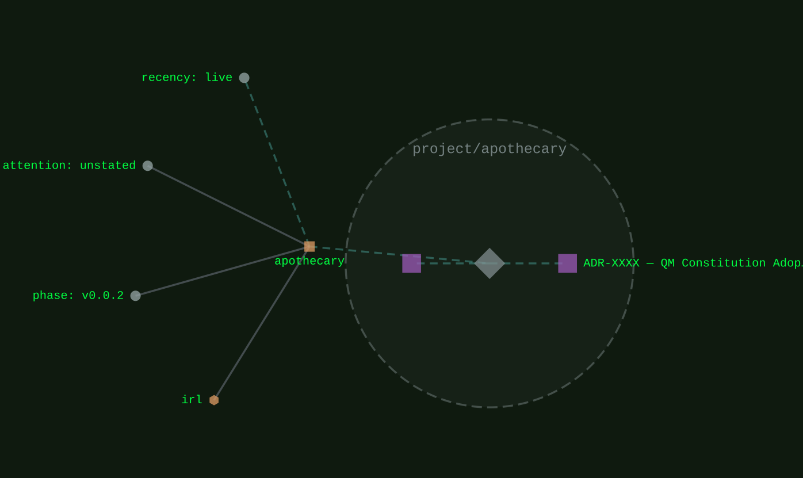
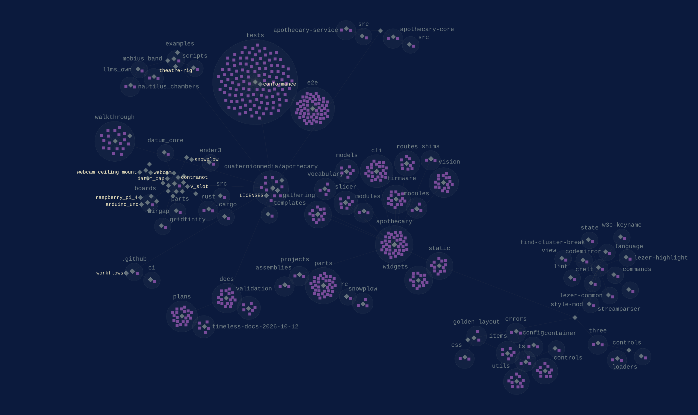

<div class="qm-hero" markdown>

<div markdown>

[irl](../families/irl.md)
{ .qm-eyebrow }

# apothecary<span class="qm-dot">.</span> { .qm-family-title .qm-f-irl }

Parts written as OpenSCAD from Python, and a viewer in the browser that zooms from a site down to any part in it. The printer, the boards, the slicer and the camera that make a part real work from the same page, on this machine.
{ .qm-lede }

```sh
git clone --recurse-submodules https://github.com/quaternionmedia/apothecary.git
cd apothecary && uv sync
uv run apothecary serve --demo
```

Then open `127.0.0.1:6283/viewer`. The demo's printer and devkit are simulated, so nothing real is touched.

[`v0.0.2`](../usage/next-steps.md#the-project-phase-ladder) · Python
{ .qm-caption }

[apothecary on GitHub](https://github.com/quaternionmedia/apothecary){ .md-button .md-button--primary }

</div>

<figure class="qm-hero-shot" markdown>

[](https://github.com/quaternionmedia/apothecary/raw/HEAD/walkthrough/screenshots/02-05-the-bench-at-the-garage-s-root-an-ender-3-at-one-e.png)

<figcaption><strong>apothecary.</strong> The garage, the world on the left with the workbench, printer_1 and a board, and the site's tree, Selected and Pictures as windows beside it.</figcaption>

</figure>

</div>

<section class="qm-section" markdown>

four loops, each round twice
{ .qm-eyebrow }

## How a part gets made

<div class="grid qm-parts" markdown>

<div class="card qm-f-irl" markdown>

**Design**

<span class="qm-meta">step 1</span>

Move a part's sizes in Parameters; each is checked once the slider rests, and Apply draws the variant.

</div>

<div class="card qm-f-irl" markdown>

**Edit its SCAD**

<span class="qm-meta">step 2</span>

Change the part's OpenSCAD in its SCAD window; a failing line is marked once typing stops, and Save keeps the change as a variant in git.

</div>

<div class="card qm-f-irl" markdown>

**A picture to a print**

<span class="qm-meta">step 3</span>

Stand a camera over the bench and take its picture, find the shapes in it, make one a piece, then slice it for printer_1 and print it.

</div>

<div class="card qm-f-irl" markdown>

**Firmware**

<span class="qm-meta">step 4</span>

Choose a sketch on the Bench, build and flash it to an ESP32 devkit, and hear it say hello in the board's Machine, in Arduino or in Rust.

</div>

</div>

<div class="grid" markdown>

<figure class="qm-shot" markdown>


<figcaption><strong>Design.</strong> A size dragged in Parameters and checked once the slider rests, the part's SCAD beside it.</figcaption>

</figure>

<figure class="qm-shot" markdown>


<figcaption><strong>Edit its SCAD.</strong> A failing assertion marked on its line in the SCAD window, the part not drawn again until it reads.</figcaption>

</figure>

<figure class="qm-shot" markdown>


<figcaption><strong>A picture to a print.</strong> The Print card in printer_1's Machine, the piece sliced by OrcaSlicer and ready to stream.</figcaption>

</figure>

<figure class="qm-shot" markdown>


<figcaption><strong>Firmware.</strong> esp32_blink flashed to the devkit, its hello heard in the board's Machine.</figcaption>

</figure>

</div>

</section>

<section class="qm-section" markdown>

the workspace
{ .qm-eyebrow }

## Windows, and a ring for every verb

Every section of the page is a window docked with Golden Layout, the shell alfred's editor and codecartographer use: a tab drags to move it, ⊞ Windows opens a closed one, and a view lays several out together. On anything in the world, `m` or Ctrl and right-click opens the ring, which holds every verb of what it opens on, each at an address the digits reach.

<figure class="qm-shot" markdown>


<figcaption>Part view, Selected and Parameters beside the part's SCAD, with the world on the left.</figcaption>

</figure>

</section>

<section class="qm-section" markdown>

photographs
{ .qm-eyebrow }

## Photographs into pieces

`apothecary photo view` finds the shapes in a photograph and stands them in the viewer as named pieces, sized from the picture's width in the world.

<figure class="qm-shot" markdown>


<figcaption>Four shapes found in a photograph, standing in the viewer as named pieces.</figcaption>

</figure>

</section>

<section class="qm-section" markdown>

on this machine
{ .qm-eyebrow }

## Personal data stays on the device

The server answers this machine only, and the process connects to nothing but a tool's publisher, when that tool is installed. A lighting console's levels may arrive, each on one UDP port, and are never answered. Under `serve --demo` the printer and the devkit are simulated and no real serial port is opened.

</section>

<section class="qm-section" markdown>

how it is built
{ .qm-eyebrow }

## A library, a server and a page

apothecary describes parts and scenes as Pydantic models and writes them as OpenSCAD; a part may also be OpenSCAD of its own, its customizer's parameters read as its parameters. The server renders, slices and drives the boards, and the page draws all of it.

<div class="grid" markdown>

<div class="card" markdown>

**the browser**

<span class="qm-meta">over HTTP, to apothecary</span>

A three.js world and Golden Layout windows, with the ring for every verb.

</div>

<div class="card qm-f-irl" markdown>

**apothecary**

<span class="qm-meta">the server and the command line</span>

FastAPI and Click over the parts library and the scene models, with each site's state kept on this machine.

</div>

<div class="card" markdown>

**OpenSCAD**

<span class="qm-meta">run by apothecary, a snapshot with Manifold</span>

Every part's STL, and every check of its SCAD.

</div>

<div class="card" markdown>

**OrcaSlicer**

<span class="qm-meta">run by apothecary, at a pinned release</span>

Slices a part or a made piece for the printer it is pinned to.

</div>

<div class="card" markdown>

**the printer and the boards**

<span class="qm-meta">over serial, or simulated under the demo</span>

An Ender 3 on Marlin, streamed G-code a line at a time; an ESP32 devkit, flashed with arduino-cli or espflash.

</div>

</div>

beside it
{ .qm-eyebrow }

<div class="grid" markdown>

<div class="card qm-f-irl" markdown>

[datum](datum.md){ .qm-card-link }

A project whose parts library extends apothecary's.

</div>

<div class="card qm-f-core" markdown>

[codecartographer](codecartographer.md){ .qm-card-link }

Draws apothecary's estate and code on this page.

</div>

<div class="card qm-f-core" markdown>

[qm](qm.md){ .qm-card-link }

The constitution apothecary is governed by, pinned as its governance submodule.

</div>

</div>

</section>

<section class="qm-section" markdown>

what it looks like
{ .qm-eyebrow }

## Showcase

the graphs codecarto draws
{ .qm-eyebrow }

### Showgraph

<div class="grid" markdown>

<figure class="qm-shot" id="showgraph-estate" markdown>

[](../show/project/apothecary/estate.svg)

<figcaption markdown="span"><strong>Where it sits.</strong> Its families, its phase, its records and the seams it is on.<br>[← alfred](alfred.md#showgraph-estate) · [every project's estate](codecartographer.md#every-projects-estate) · [benchmark →](benchmark.md#showgraph-estate)</figcaption>

</figure>

<figure class="qm-shot" id="showgraph-code" markdown>

[](../show/project/apothecary/code.svg)

<figcaption markdown="span"><strong>Its code.</strong> Its default branch, by directory, file and symbol.<br>[← alfred](alfred.md#showgraph-code) · [every project's code](codecartographer.md#every-projects-code) · [benchmark →](benchmark.md#showgraph-code)</figcaption>

</figure>

</div>

**Its system:** not drawn. apothecary declares no system this window reads: no Helm chart, ArgoCD Application, Terraform or Dockerfile.
{ .qm-caption }

Drawn by codecartographer at `92c5a4c` from the corpus at `bb2ed17` and apothecary's default branch at `ac25b8d`, on 2026-10-29. [The show document](../show/project/apothecary/show.json) holds each graph as drawn.
{ .qm-caption }

</section>

Generated by `uv run qm cookbook docs/families --site --write` from `families.json`, the inventory, `ci/showcase.yaml` and the show documents `uv run codecarto show export` writes into `docs/show/`. The families are decided in the [family record](https://github.com/quaternionmedia/qm/blob/main/records/DRAFT-a-family-is-bordered-by-what-it-drives.md); edit the roster, the record or the showcase, not this page.
{ .qm-caption }
