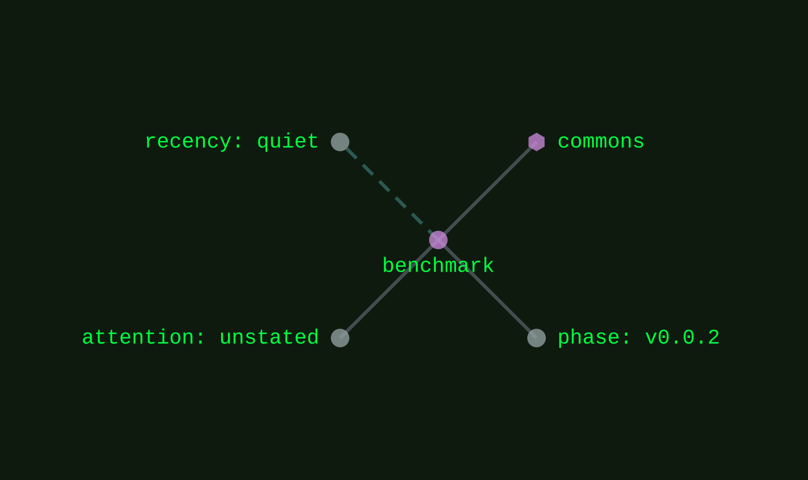
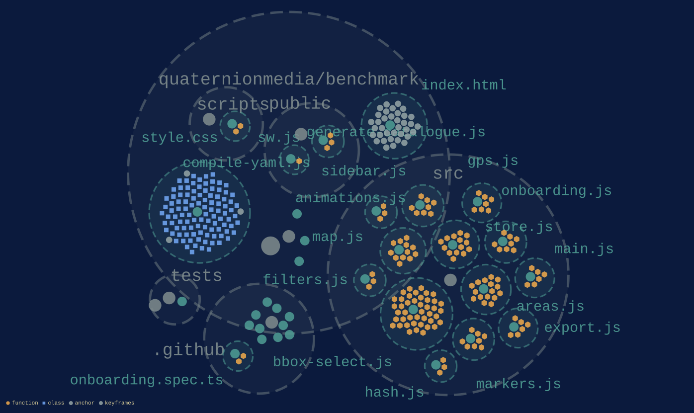

[commons](../families/commons.md)
{ .qm-eyebrow }

# benchmark. { .qm-family-title .qm-f-commons }

A place to keep track of benches

[`v0.0.0`](../usage/next-steps.md#the-project-phase-ladder) · `v0.0.2` stated · JavaScript
{ .qm-caption }

[benchmark on GitHub](https://github.com/quaternionmedia/benchmark){ .md-button .md-button--primary }

No pictures are listed for benchmark yet. A project's own screenshots are picked in the corpus's `ci/showcase.yaml`.
{ .qm-caption }

<section class="qm-section" markdown>

what it looks like
{ .qm-eyebrow }

## Showcase

the graphs codecarto draws
{ .qm-eyebrow }

### Showgraph

<figure class="qm-shot" id="showgraph-estate" markdown>

<figcaption markdown="span"><strong>Where it sits.</strong> Its families, its phase, its records and the seams it is on. [← apothecary](apothecary.md#showgraph-estate) · [every project's estate](codecartographer.md#every-projects-estate) · [carlos →](carlos.md#showgraph-estate)</figcaption>

</figure>

<figure class="qm-shot" id="showgraph-code" markdown>

<figcaption markdown="span"><strong>Its code.</strong> Its default branch, by directory, file and symbol. [← apothecary](apothecary.md#showgraph-code) · [every project's code](codecartographer.md#every-projects-code) · [carlos →](carlos.md#showgraph-code)</figcaption>

</figure>

**Its system:** not drawn. benchmark's system view is composed from a clone of it, and this export read none.
{ .qm-caption }

Drawn by codecartographer at `ada6a1b` from the corpus at `6906aee` and benchmark's default branch at `dfae9d2`, on 2026-10-27. [The show document](../show/project/benchmark/show.json) holds each graph as drawn.
{ .qm-caption }

</section>

Generated by `uv run qm cookbook docs/families --site --write` from `families.json`, the inventory, `ci/showcase.yaml` and the show documents `uv run codecarto show export` writes into `docs/show/`. The families are decided in the [family record](https://github.com/quaternionmedia/qm/blob/main/records/DRAFT-a-family-is-bordered-by-what-it-drives.md); edit the roster, the record or the showcase, not this page.
{ .qm-caption }
