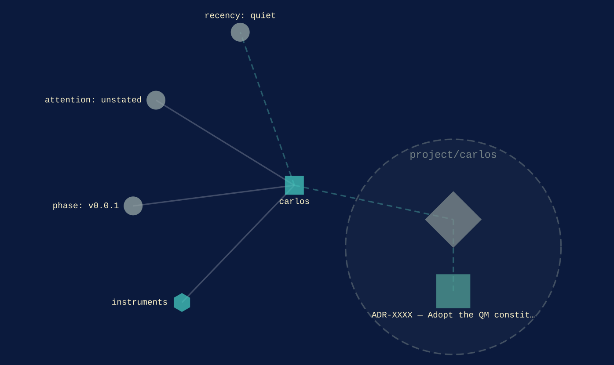
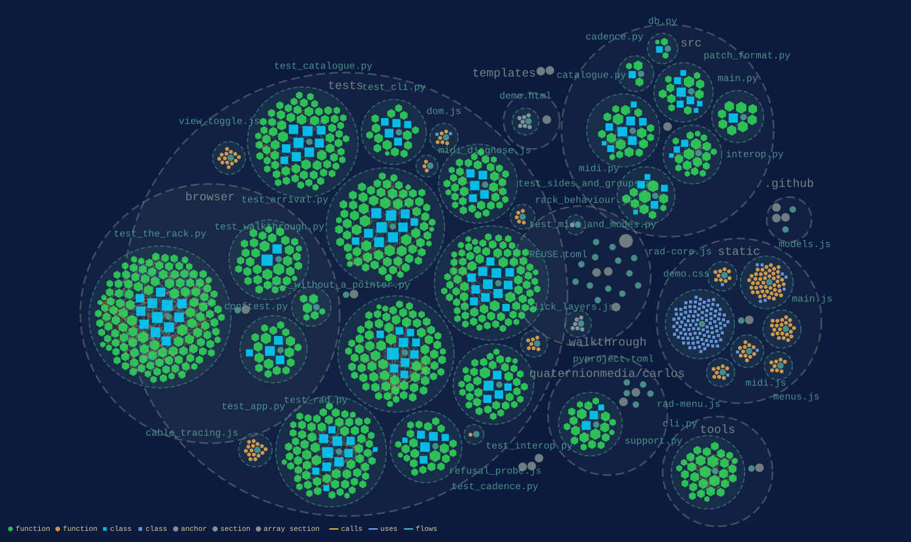

[instruments](../families/instruments.md) · within [performing](../families/performing.md)
{ .qm-eyebrow }

# carlos. { .qm-family-title .qm-f-instruments }

Browser workspace for sketching hardware rigs from real gear, patched on the face its sockets are on

[`v0.0.1`](../usage/next-steps.md#the-project-phase-ladder) · Python
{ .qm-caption }

[carlos on GitHub](https://github.com/quaternionmedia/carlos){ .md-button .md-button--primary }

<figure class="qm-hero-shot" markdown>

<figcaption><strong>carlos.</strong> Two drum voices wired to a Novation Launchpad X and a Squarp Hapax.</figcaption>

</figure>

<section class="qm-section" markdown>

what it looks like
{ .qm-eyebrow }

## Showcase

<figure class="qm-shot" markdown>

<figcaption>A whole rig from the back panels, with the radial menu open.</figcaption>

</figure>

<figure class="qm-shot" markdown>

<figcaption>An imported rig, a grid playing a modular drum voice, with its cables drawn.</figcaption>

</figure>

the graphs codecarto draws
{ .qm-eyebrow }

### Showgraph

<figure class="qm-shot" markdown>

<figcaption><strong>Where it sits.</strong> Its families, its phase, its records and the seams it is on.</figcaption>

</figure>

<figure class="qm-shot" markdown>

<figcaption><strong>Its code.</strong> Its default branch, by directory and file.</figcaption>

</figure>

**Its system:** not drawn. carlos declares no system this window reads: no Helm chart, ArgoCD Application, Terraform or Dockerfile.
{ .qm-caption }

Drawn by codecartographer at `99602ff` from the corpus at `e1d1306` and carlos's default branch at `a5540e7`, on 2026-10-27. [The show document](../show/project/carlos/show.json) holds each graph as drawn.
{ .qm-caption }

</section>

Generated by `uv run qm cookbook docs/families --site --write` from `families.json`, the inventory, `ci/showcase.yaml` and the show documents `uv run codecarto show export` writes into `docs/show/`. The families are decided in the [family record](https://github.com/quaternionmedia/qm/blob/main/records/DRAFT-a-family-is-bordered-by-what-it-drives.md); edit the roster, the record or the showcase, not this page.
{ .qm-caption }
