[core](../families/core.md)
{ .qm-eyebrow }

# codecartographer. { .qm-family-title .qm-f-core }

Project for mapping code

[`v0.0.2`](../usage/next-steps.md#the-project-phase-ladder) · Python
{ .qm-caption }

[codecartographer on GitHub](https://github.com/quaternionmedia/codecartographer){ .md-button .md-button--primary }

No pictures are listed for codecartographer yet. A project's own screenshots are picked in the corpus's `ci/showcase.yaml`.
{ .qm-caption }

<section class="qm-section" markdown>

what it looks like
{ .qm-eyebrow }

## Showcase

the graphs codecarto draws
{ .qm-eyebrow }

### Showgraph

<figure class="qm-shot" id="showgraph-estate" markdown>

[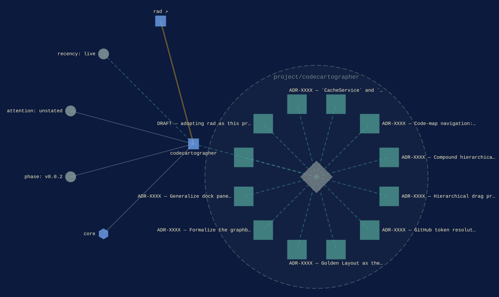](../show/project/codecartographer/estate.svg)

<figcaption markdown="span"><strong>Where it sits.</strong> Its families, its phase, its records and the seams it is on. [← cesar](cesar.md#showgraph-estate) · [every project's estate](codecartographer.md#every-projects-estate) · [Cuelist-python →](Cuelist-python.md#showgraph-estate)</figcaption>

</figure>

<figure class="qm-shot" id="showgraph-code" markdown>

[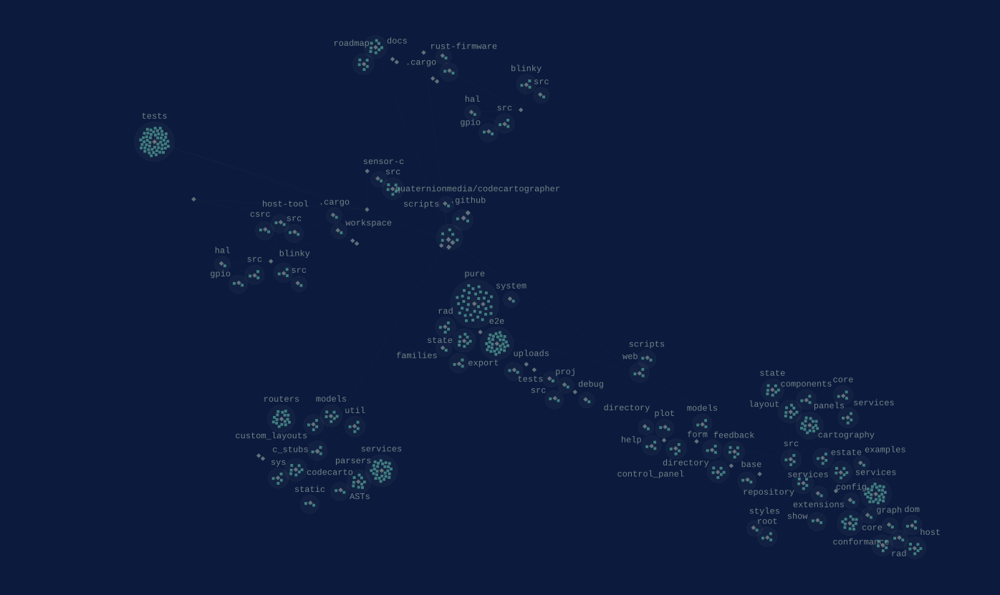](../show/project/codecartographer/code.svg)

<figcaption markdown="span"><strong>Its code.</strong> Its default branch, by directory, file and symbol. [← cesar](cesar.md#showgraph-code) · [every project's code](codecartographer.md#every-projects-code) · [Cuelist-python →](Cuelist-python.md#showgraph-code)</figcaption>

</figure>

**Its system:** not drawn. codecartographer's system view is composed from a clone of it, and the clone this export read was not at its default branch's head, 7c175d6.
{ .qm-caption }

Drawn by codecartographer at `92c5a4c` from the corpus at `bb2ed17` and codecartographer's default branch at `7c175d6`, on 2026-10-29. [The show document](../show/project/codecartographer/show.json) holds each graph as drawn.
{ .qm-caption }

### Every showgraph { #every-showgraph }

Every graph codecartographer draws for these pages, in one place: the whole corpus a family at a time, each family with its projects' code, then each view of every project and every family. Each picture opens the page it is on, and each page steps to the same graph of the projects beside it.

#### Every family's code { #every-familys-code }

<figure class="qm-shot" markdown>

[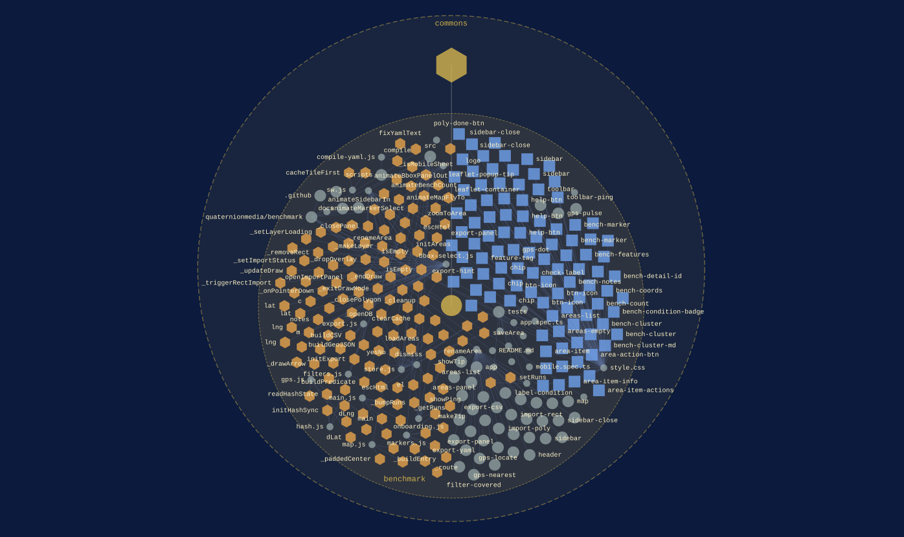{ loading=lazy }](../families/commons.md#showgraph-code)

<figcaption markdown="span">[commons](../families/commons.md#showgraph-code), 1 project's code</figcaption>

</figure>

<figure class="qm-shot" markdown>

[{ loading=lazy }](../families/core.md#showgraph-code)

<figcaption markdown="span">[core](../families/core.md#showgraph-code), 7 projects' code</figcaption>

</figure>

<figure class="qm-shot" markdown>

[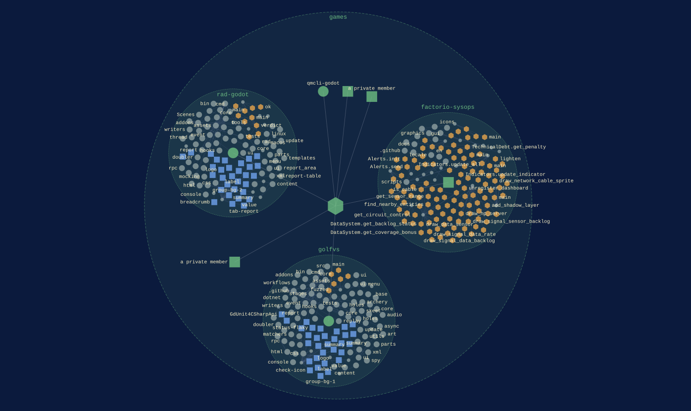{ loading=lazy }](../families/games.md#showgraph-code)

<figcaption markdown="span">[games](../families/games.md#showgraph-code), 3 projects' code</figcaption>

</figure>

<figure class="qm-shot" markdown>

[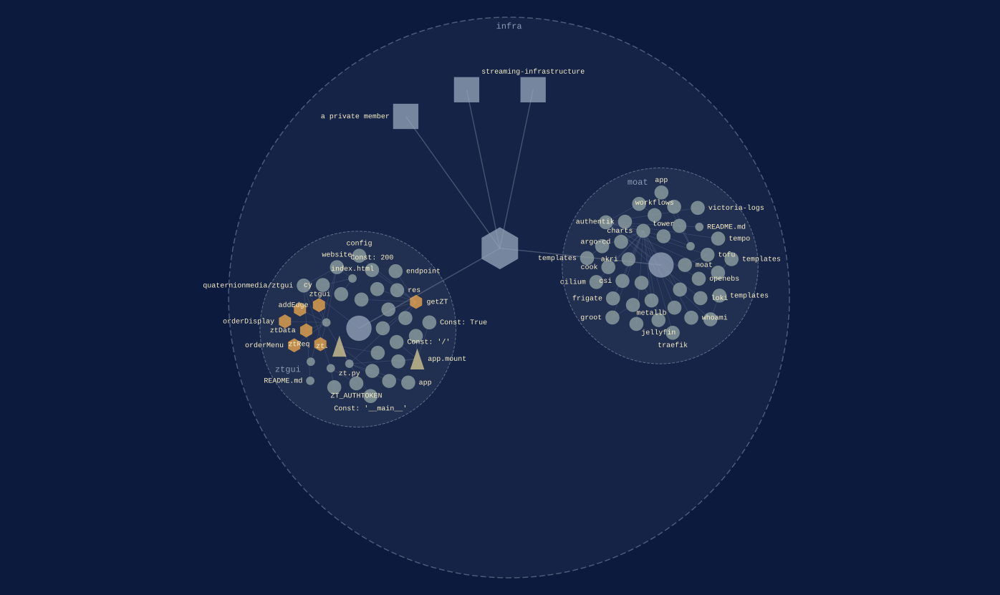{ loading=lazy }](../families/infra.md#showgraph-code)

<figcaption markdown="span">[infra](../families/infra.md#showgraph-code), 2 projects' code</figcaption>

</figure>

<figure class="qm-shot" markdown>

[{ loading=lazy }](../families/instruments.md#showgraph-code)

<figcaption markdown="span">[instruments](../families/instruments.md#showgraph-code), 9 projects' code</figcaption>

</figure>

<figure class="qm-shot" markdown>

[{ loading=lazy }](../families/irl.md#showgraph-code)

<figcaption markdown="span">[irl](../families/irl.md#showgraph-code), 6 projects' code</figcaption>

</figure>

<figure class="qm-shot" markdown>

[{ loading=lazy }](../families/performer-display.md#showgraph-code)

<figcaption markdown="span">[performer-display](../families/performer-display.md#showgraph-code), 2 projects' code</figcaption>

</figure>

<figure class="qm-shot" markdown>

[{ loading=lazy }](../families/performing.md#showgraph-code)

<figcaption markdown="span">[performing](../families/performing.md#showgraph-code), 21 projects' code</figcaption>

</figure>

<figure class="qm-shot" markdown>

[{ loading=lazy }](../families/show-control.md#showgraph-code)

<figcaption markdown="span">[show-control](../families/show-control.md#showgraph-code), 8 projects' code</figcaption>

</figure>

#### Every project's code { #every-projects-code }

<figure class="qm-shot" markdown>

[{ loading=lazy }](aes.md#showgraph-code)

<figcaption markdown="span">[aes](aes.md#showgraph-code), 4 nodes, to its files</figcaption>

</figure>

<figure class="qm-shot" markdown>

[{ loading=lazy }](alfred.md#showgraph-code)

<figcaption markdown="span">[alfred](alfred.md#showgraph-code), 390 nodes, to its symbols</figcaption>

</figure>

<figure class="qm-shot" markdown>

[{ loading=lazy }](apothecary.md#showgraph-code)

<figcaption markdown="span">[apothecary](apothecary.md#showgraph-code), 8,869 nodes, to its symbols</figcaption>

</figure>

<figure class="qm-shot" markdown>

[{ loading=lazy }](benchmark.md#showgraph-code)

<figcaption markdown="span">[benchmark](benchmark.md#showgraph-code), 327 nodes, to its symbols</figcaption>

</figure>

<figure class="qm-shot" markdown>

[{ loading=lazy }](carlos.md#showgraph-code)

<figcaption markdown="span">[carlos](carlos.md#showgraph-code), 1,232 nodes, to its symbols</figcaption>

</figure>

<figure class="qm-shot" markdown>

[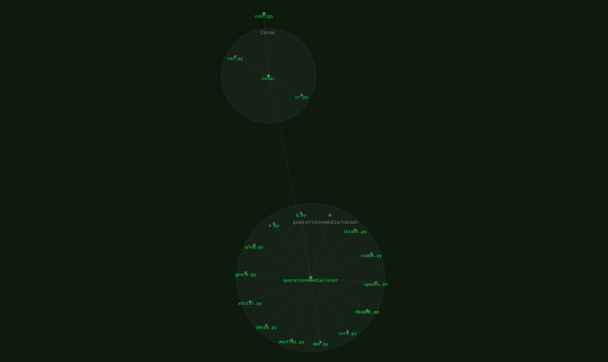{ loading=lazy }](cesar.md#showgraph-code)

<figcaption markdown="span">[cesar](cesar.md#showgraph-code), 183 nodes, to its symbols</figcaption>

</figure>

<figure class="qm-shot" markdown>

[{ loading=lazy }](codecartographer.md#showgraph-code)

<figcaption markdown="span">[codecartographer](codecartographer.md#showgraph-code), 4,121 nodes, to its symbols</figcaption>

</figure>

<figure class="qm-shot" markdown>

[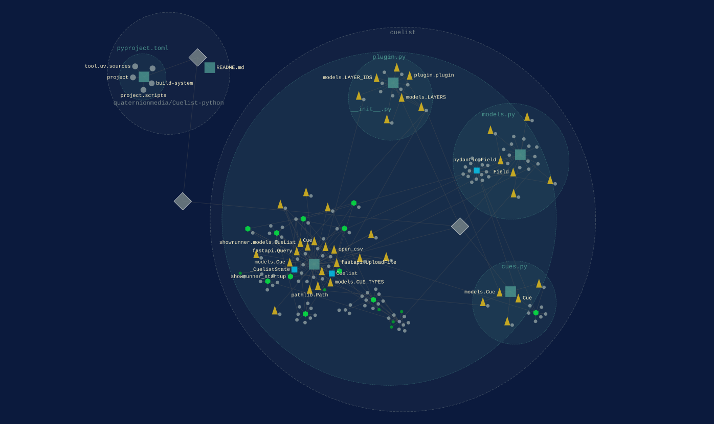{ loading=lazy }](Cuelist-python.md#showgraph-code)

<figcaption markdown="span">[Cuelist-python](Cuelist-python.md#showgraph-code), 138 nodes, to its members</figcaption>

</figure>

<figure class="qm-shot" markdown>

[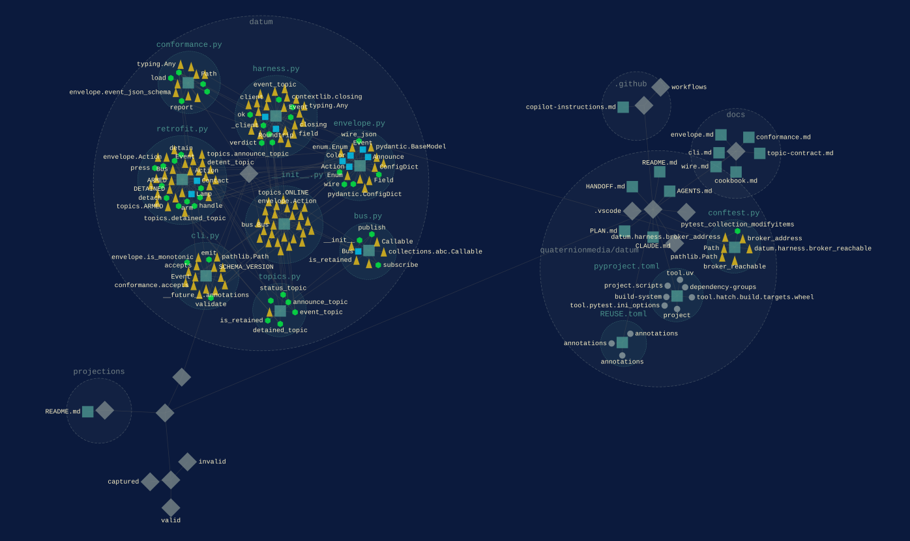{ loading=lazy }](datum.md#showgraph-code)

<figcaption markdown="span">[datum](datum.md#showgraph-code), 437 nodes, to its members</figcaption>

</figure>

<figure class="qm-shot" markdown>

[{ loading=lazy }](dossier.md#showgraph-code)

<figcaption markdown="span">[dossier](dossier.md#showgraph-code), 3,069 nodes, to its symbols</figcaption>

</figure>

<figure class="qm-shot" markdown>

[{ loading=lazy }](factorio-sysops.md#showgraph-code)

<figcaption markdown="span">[factorio-sysops](factorio-sysops.md#showgraph-code), 152 nodes, to its symbols</figcaption>

</figure>

<figure class="qm-shot" markdown>

[{ loading=lazy }](golfvs.md#showgraph-code)

<figcaption markdown="span">[golfvs](golfvs.md#showgraph-code), 132 nodes, to its symbols</figcaption>

</figure>

<figure class="qm-shot" markdown>

[{ loading=lazy }](holophonor.md#showgraph-code)

<figcaption markdown="span">[holophonor](holophonor.md#showgraph-code), 110 nodes, to its symbols</figcaption>

</figure>

<figure class="qm-shot" markdown>

[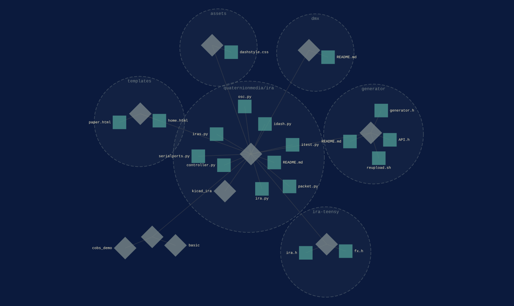{ loading=lazy }](ira.md#showgraph-code)

<figcaption markdown="span">[ira](ira.md#showgraph-code), 373 nodes, to its members</figcaption>

</figure>

<figure class="qm-shot" markdown>

[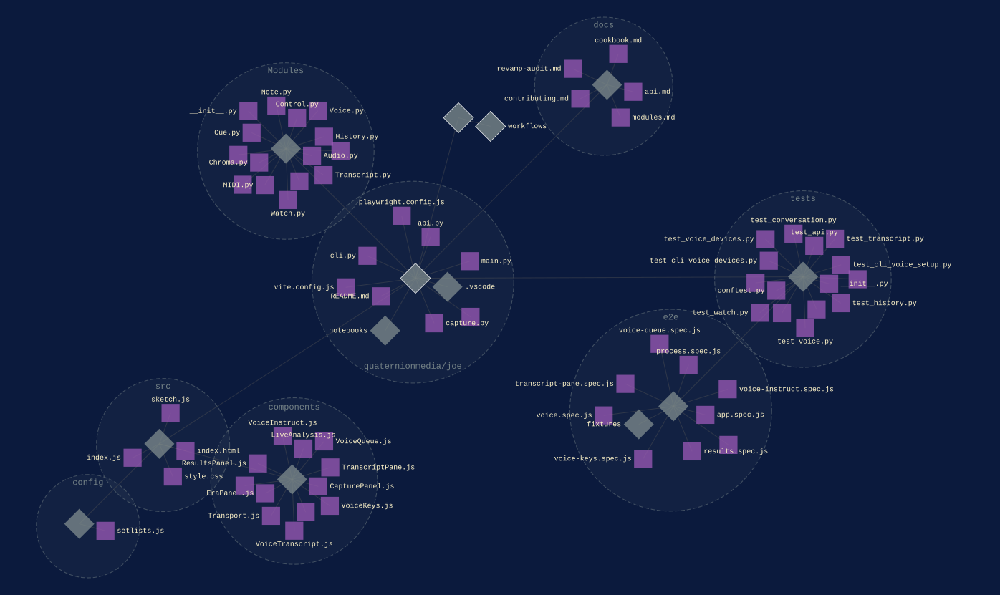{ loading=lazy }](joe.md#showgraph-code)

<figcaption markdown="span">[joe](joe.md#showgraph-code), 661 nodes, to its symbols</figcaption>

</figure>

<figure class="qm-shot" markdown>

[{ loading=lazy }](leo.md#showgraph-code)

<figcaption markdown="span">[leo](leo.md#showgraph-code), 371 nodes, to its symbols</figcaption>

</figure>

<figure class="qm-shot" markdown>

[{ loading=lazy }](looksatwords.md#showgraph-code)

<figcaption markdown="span">[looksatwords](looksatwords.md#showgraph-code), 951 nodes, to its symbols</figcaption>

</figure>

<figure class="qm-shot" markdown>

[{ loading=lazy }](ludwig.md#showgraph-code)

<figcaption markdown="span">[ludwig](ludwig.md#showgraph-code), 342 nodes, to its members</figcaption>

</figure>

<figure class="qm-shot" markdown>

[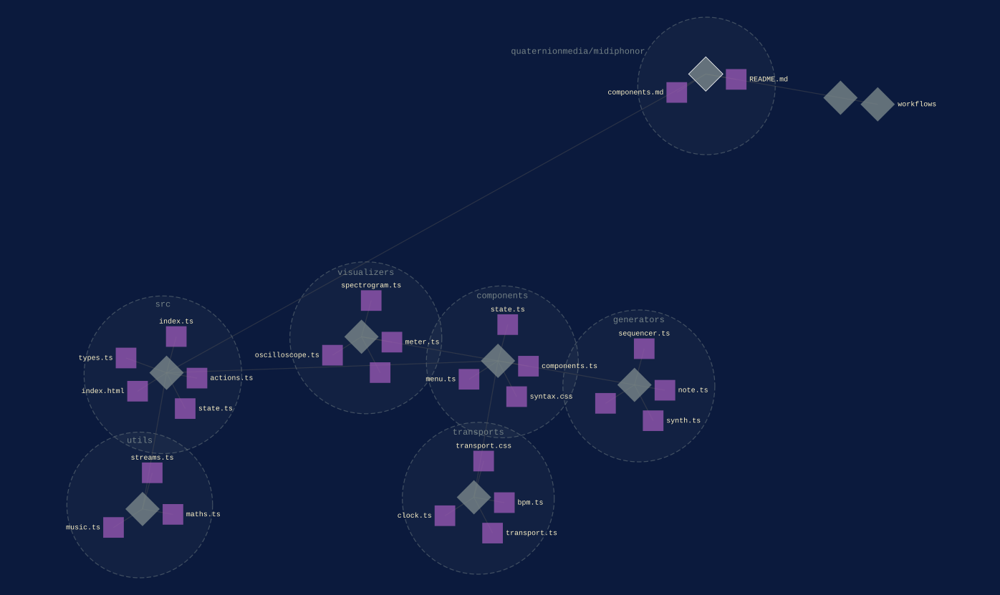{ loading=lazy }](midiphonor.md#showgraph-code)

<figcaption markdown="span">[midiphonor](midiphonor.md#showgraph-code), 63 nodes, to its symbols</figcaption>

</figure>

<figure class="qm-shot" markdown>

[{ loading=lazy }](moat.md#showgraph-code)

<figcaption markdown="span">[moat](moat.md#showgraph-code), 39 nodes, to its members</figcaption>

</figure>

<figure class="qm-shot" markdown>

[{ loading=lazy }](otto.md#showgraph-code)

<figcaption markdown="span">[otto](otto.md#showgraph-code), 109 nodes, to its symbols</figcaption>

</figure>

<figure class="qm-shot" markdown>

[{ loading=lazy }](QLab-python.md#showgraph-code)

<figcaption markdown="span">[QLab-python](QLab-python.md#showgraph-code), 319 nodes, to its members</figcaption>

</figure>

<figure class="qm-shot" markdown>

[{ loading=lazy }](qm.md#showgraph-code)

<figcaption markdown="span">[qm](qm.md#showgraph-code), 3,453 nodes, to its symbols</figcaption>

</figure>

<figure class="qm-shot" markdown>

[{ loading=lazy }](qmcp.md#showgraph-code)

<figcaption markdown="span">[qmcp](qmcp.md#showgraph-code), 3,751 nodes, to its symbols</figcaption>

</figure>

<figure class="qm-shot" markdown>

[{ loading=lazy }](qmetronome.md#showgraph-code)

<figcaption markdown="span">[qmetronome](qmetronome.md#showgraph-code), 764 nodes, to its symbols</figcaption>

</figure>

<figure class="qm-shot" markdown>

[{ loading=lazy }](rad.md#showgraph-code)

<figcaption markdown="span">[rad](rad.md#showgraph-code), 153 nodes, to its symbols</figcaption>

</figure>

<figure class="qm-shot" markdown>

[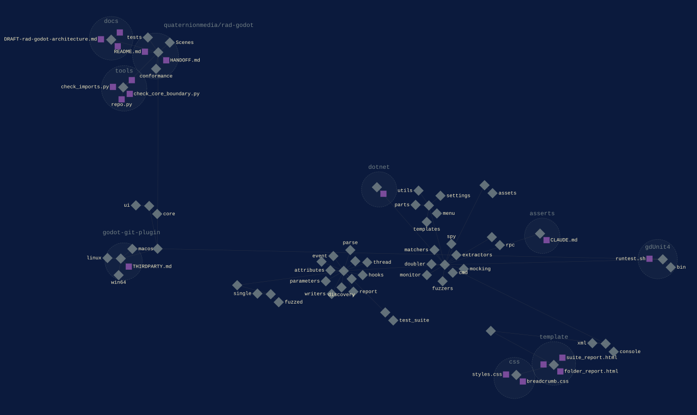{ loading=lazy }](rad-godot.md#showgraph-code)

<figcaption markdown="span">[rad-godot](rad-godot.md#showgraph-code), 123 nodes, to its symbols</figcaption>

</figure>

<figure class="qm-shot" markdown>

[{ loading=lazy }](scad-chess.md#showgraph-code)

<figcaption markdown="span">[scad-chess](scad-chess.md#showgraph-code), 5 nodes, to its files</figcaption>

</figure>

<figure class="qm-shot" markdown>

[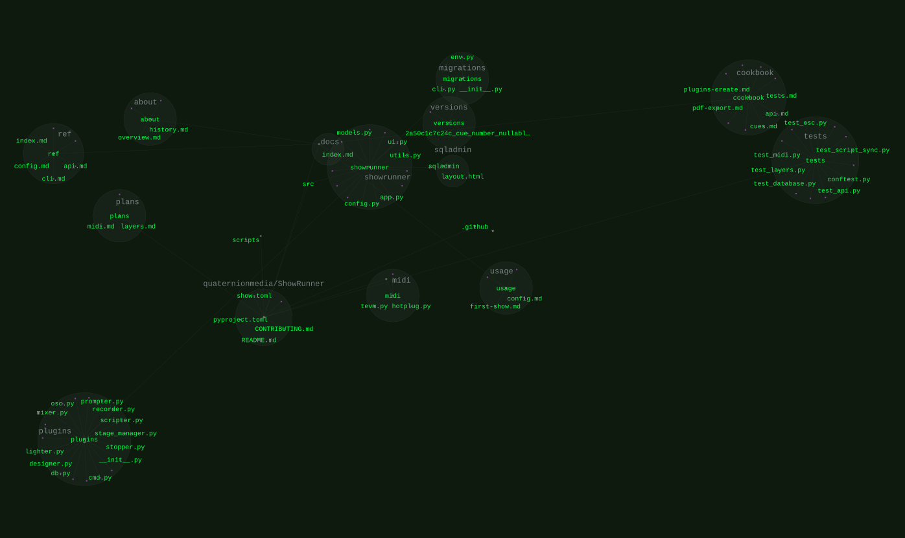{ loading=lazy }](ShowRunner.md#showgraph-code)

<figcaption markdown="span">[ShowRunner](ShowRunner.md#showgraph-code), 945 nodes, to its symbols</figcaption>

</figure>

<figure class="qm-shot" markdown>

[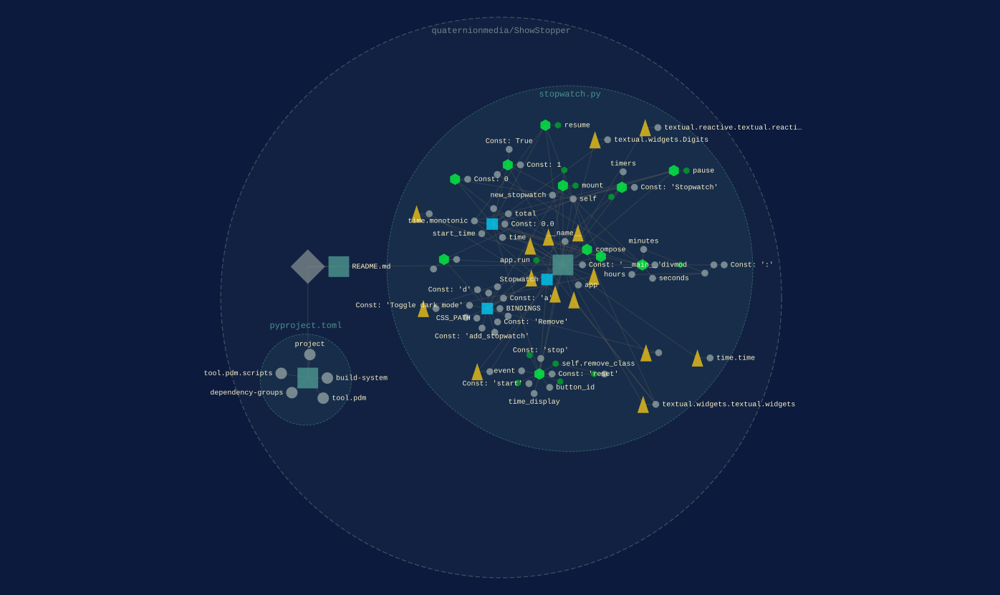{ loading=lazy }](ShowStopper.md#showgraph-code)

<figcaption markdown="span">[ShowStopper](ShowStopper.md#showgraph-code), 83 nodes, to its members</figcaption>

</figure>

<figure class="qm-shot" markdown>

[{ loading=lazy }](stomp.md#showgraph-code)

<figcaption markdown="span">[stomp](stomp.md#showgraph-code), 3 nodes, to its files</figcaption>

</figure>

<figure class="qm-shot" markdown>

[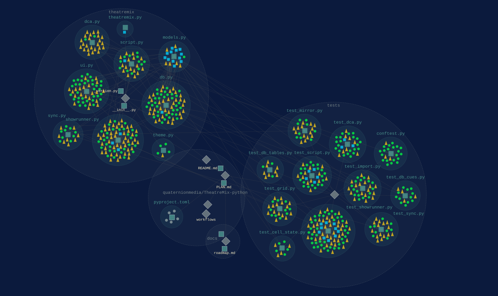{ loading=lazy }](TheatreMix-python.md#showgraph-code)

<figcaption markdown="span">[TheatreMix-python](TheatreMix-python.md#showgraph-code), 365 nodes, to its symbols</figcaption>

</figure>

<figure class="qm-shot" markdown>

[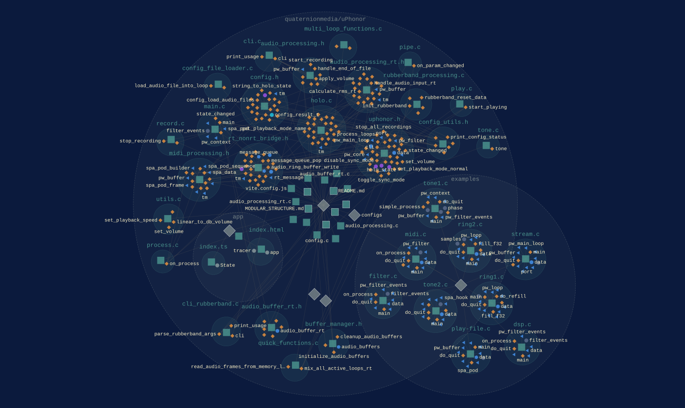{ loading=lazy }](uPhonor.md#showgraph-code)

<figcaption markdown="span">[uPhonor](uPhonor.md#showgraph-code), 418 nodes, to its symbols</figcaption>

</figure>

<figure class="qm-shot" markdown>

[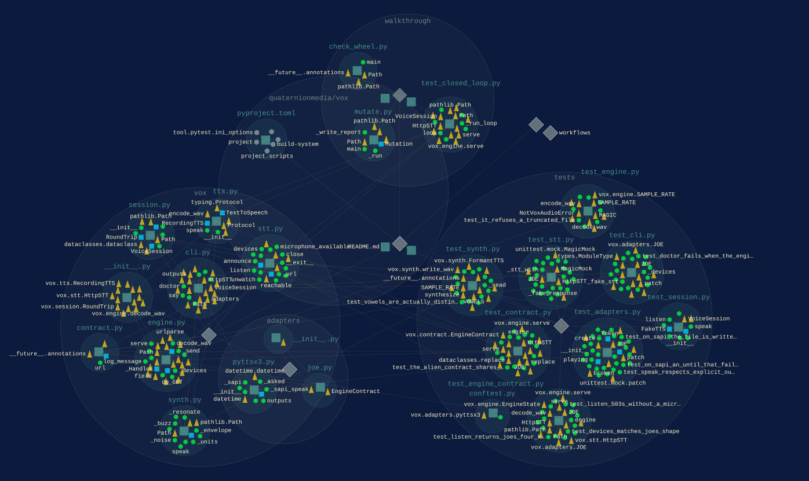{ loading=lazy }](vox.md#showgraph-code)

<figcaption markdown="span">[vox](vox.md#showgraph-code), 264 nodes, to its symbols</figcaption>

</figure>

<figure class="qm-shot" markdown>

[{ loading=lazy }](waveofhormuz.md#showgraph-code)

<figcaption markdown="span">[waveofhormuz](waveofhormuz.md#showgraph-code), 22 nodes, to its symbols</figcaption>

</figure>

<figure class="qm-shot" markdown>

[{ loading=lazy }](wolf.md#showgraph-code)

<figcaption markdown="span">[wolf](wolf.md#showgraph-code), 608 nodes, to its members</figcaption>

</figure>

<figure class="qm-shot" markdown>

[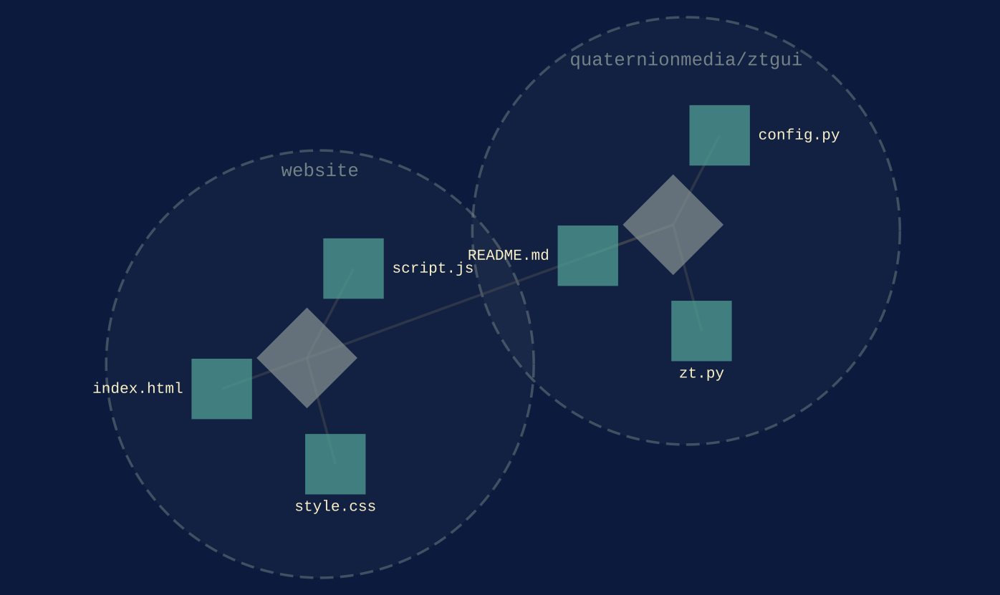{ loading=lazy }](ztgui.md#showgraph-code)

<figcaption markdown="span">[ztgui](ztgui.md#showgraph-code), 39 nodes, to its members</figcaption>

</figure>

#### Every project's estate { #every-projects-estate }

<figure class="qm-shot" markdown>

[{ loading=lazy }](aes.md#showgraph-estate)

<figcaption markdown="span">[aes](aes.md#showgraph-estate)</figcaption>

</figure>

<figure class="qm-shot" markdown>

[{ loading=lazy }](alfred.md#showgraph-estate)

<figcaption markdown="span">[alfred](alfred.md#showgraph-estate)</figcaption>

</figure>

<figure class="qm-shot" markdown>

[{ loading=lazy }](apothecary.md#showgraph-estate)

<figcaption markdown="span">[apothecary](apothecary.md#showgraph-estate)</figcaption>

</figure>

<figure class="qm-shot" markdown>

[{ loading=lazy }](benchmark.md#showgraph-estate)

<figcaption markdown="span">[benchmark](benchmark.md#showgraph-estate)</figcaption>

</figure>

<figure class="qm-shot" markdown>

[{ loading=lazy }](carlos.md#showgraph-estate)

<figcaption markdown="span">[carlos](carlos.md#showgraph-estate)</figcaption>

</figure>

<figure class="qm-shot" markdown>

[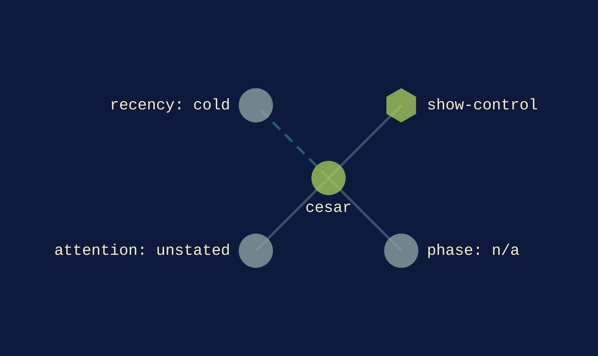{ loading=lazy }](cesar.md#showgraph-estate)

<figcaption markdown="span">[cesar](cesar.md#showgraph-estate)</figcaption>

</figure>

<figure class="qm-shot" markdown>

[{ loading=lazy }](codecartographer.md#showgraph-estate)

<figcaption markdown="span">[codecartographer](codecartographer.md#showgraph-estate)</figcaption>

</figure>

<figure class="qm-shot" markdown>

[{ loading=lazy }](Cuelist-python.md#showgraph-estate)

<figcaption markdown="span">[Cuelist-python](Cuelist-python.md#showgraph-estate)</figcaption>

</figure>

<figure class="qm-shot" markdown>

[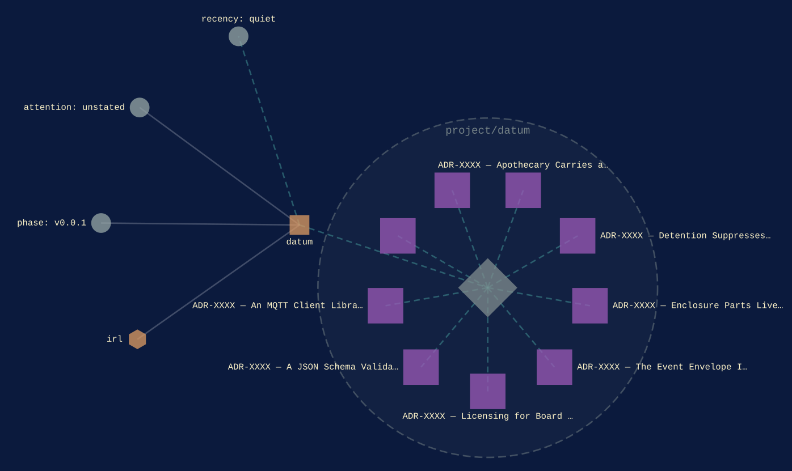{ loading=lazy }](datum.md#showgraph-estate)

<figcaption markdown="span">[datum](datum.md#showgraph-estate)</figcaption>

</figure>

<figure class="qm-shot" markdown>

[{ loading=lazy }](dossier.md#showgraph-estate)

<figcaption markdown="span">[dossier](dossier.md#showgraph-estate)</figcaption>

</figure>

<figure class="qm-shot" markdown>

[{ loading=lazy }](factorio-sysops.md#showgraph-estate)

<figcaption markdown="span">[factorio-sysops](factorio-sysops.md#showgraph-estate)</figcaption>

</figure>

<figure class="qm-shot" markdown>

[{ loading=lazy }](golfvs.md#showgraph-estate)

<figcaption markdown="span">[golfvs](golfvs.md#showgraph-estate)</figcaption>

</figure>

<figure class="qm-shot" markdown>

[{ loading=lazy }](holophonor.md#showgraph-estate)

<figcaption markdown="span">[holophonor](holophonor.md#showgraph-estate)</figcaption>

</figure>

<figure class="qm-shot" markdown>

[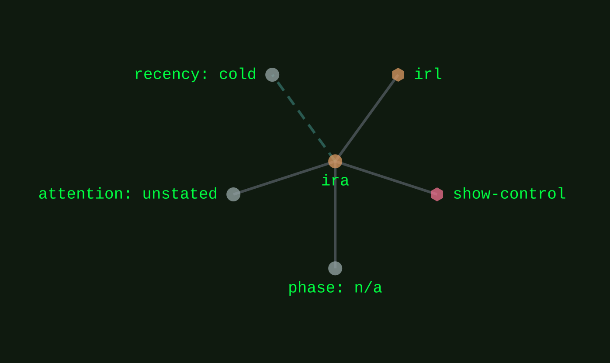{ loading=lazy }](ira.md#showgraph-estate)

<figcaption markdown="span">[ira](ira.md#showgraph-estate)</figcaption>

</figure>

<figure class="qm-shot" markdown>

[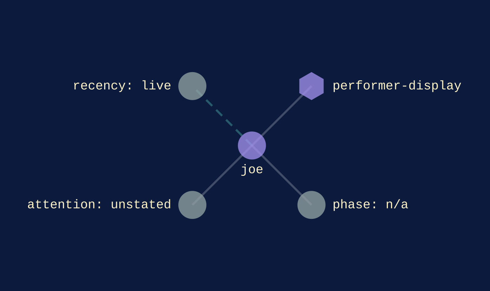{ loading=lazy }](joe.md#showgraph-estate)

<figcaption markdown="span">[joe](joe.md#showgraph-estate)</figcaption>

</figure>

<figure class="qm-shot" markdown>

[{ loading=lazy }](leo.md#showgraph-estate)

<figcaption markdown="span">[leo](leo.md#showgraph-estate)</figcaption>

</figure>

<figure class="qm-shot" markdown>

[{ loading=lazy }](looksatwords.md#showgraph-estate)

<figcaption markdown="span">[looksatwords](looksatwords.md#showgraph-estate)</figcaption>

</figure>

<figure class="qm-shot" markdown>

[{ loading=lazy }](ludwig.md#showgraph-estate)

<figcaption markdown="span">[ludwig](ludwig.md#showgraph-estate)</figcaption>

</figure>

<figure class="qm-shot" markdown>

[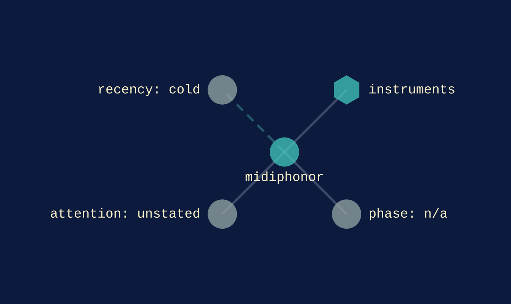{ loading=lazy }](midiphonor.md#showgraph-estate)

<figcaption markdown="span">[midiphonor](midiphonor.md#showgraph-estate)</figcaption>

</figure>

<figure class="qm-shot" markdown>

[{ loading=lazy }](moat.md#showgraph-estate)

<figcaption markdown="span">[moat](moat.md#showgraph-estate)</figcaption>

</figure>

<figure class="qm-shot" markdown>

[{ loading=lazy }](otto.md#showgraph-estate)

<figcaption markdown="span">[otto](otto.md#showgraph-estate)</figcaption>

</figure>

<figure class="qm-shot" markdown>

[{ loading=lazy }](QLab-python.md#showgraph-estate)

<figcaption markdown="span">[QLab-python](QLab-python.md#showgraph-estate)</figcaption>

</figure>

<figure class="qm-shot" markdown>

[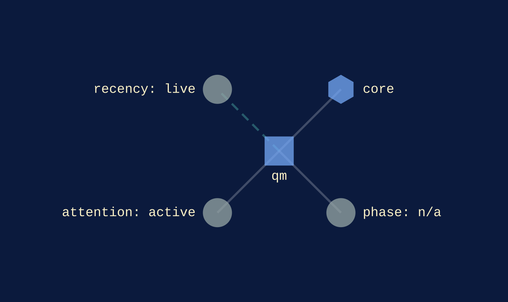{ loading=lazy }](qm.md#showgraph-estate)

<figcaption markdown="span">[qm](qm.md#showgraph-estate)</figcaption>

</figure>

<figure class="qm-shot" markdown>

[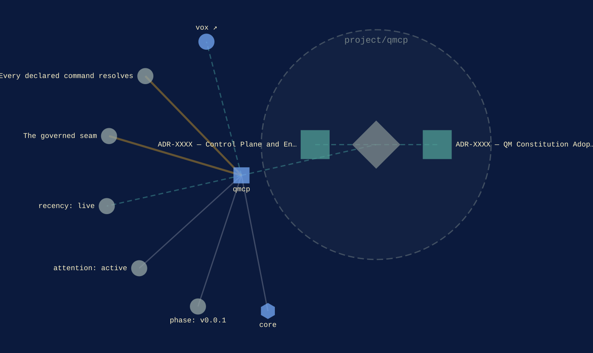{ loading=lazy }](qmcp.md#showgraph-estate)

<figcaption markdown="span">[qmcp](qmcp.md#showgraph-estate)</figcaption>

</figure>

<figure class="qm-shot" markdown>

[{ loading=lazy }](qmetronome.md#showgraph-estate)

<figcaption markdown="span">[qmetronome](qmetronome.md#showgraph-estate)</figcaption>

</figure>

<figure class="qm-shot" markdown>

[{ loading=lazy }](rad.md#showgraph-estate)

<figcaption markdown="span">[rad](rad.md#showgraph-estate)</figcaption>

</figure>

<figure class="qm-shot" markdown>

[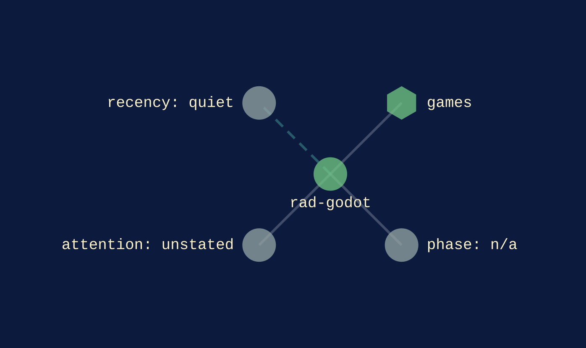{ loading=lazy }](rad-godot.md#showgraph-estate)

<figcaption markdown="span">[rad-godot](rad-godot.md#showgraph-estate)</figcaption>

</figure>

<figure class="qm-shot" markdown>

[{ loading=lazy }](scad-chess.md#showgraph-estate)

<figcaption markdown="span">[scad-chess](scad-chess.md#showgraph-estate)</figcaption>

</figure>

<figure class="qm-shot" markdown>

[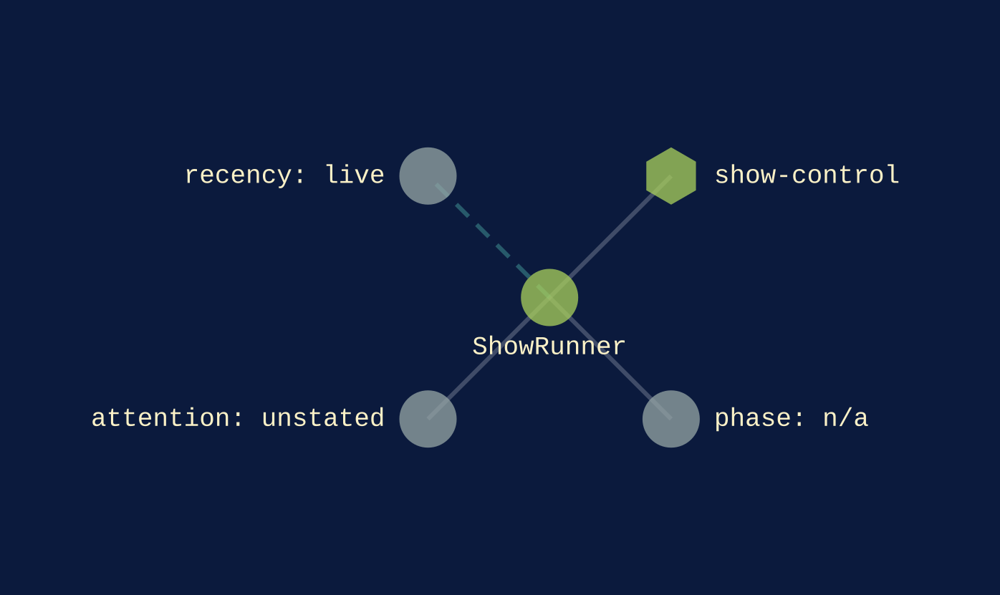{ loading=lazy }](ShowRunner.md#showgraph-estate)

<figcaption markdown="span">[ShowRunner](ShowRunner.md#showgraph-estate)</figcaption>

</figure>

<figure class="qm-shot" markdown>

[{ loading=lazy }](ShowStopper.md#showgraph-estate)

<figcaption markdown="span">[ShowStopper](ShowStopper.md#showgraph-estate)</figcaption>

</figure>

<figure class="qm-shot" markdown>

[{ loading=lazy }](stomp.md#showgraph-estate)

<figcaption markdown="span">[stomp](stomp.md#showgraph-estate)</figcaption>

</figure>

<figure class="qm-shot" markdown>

[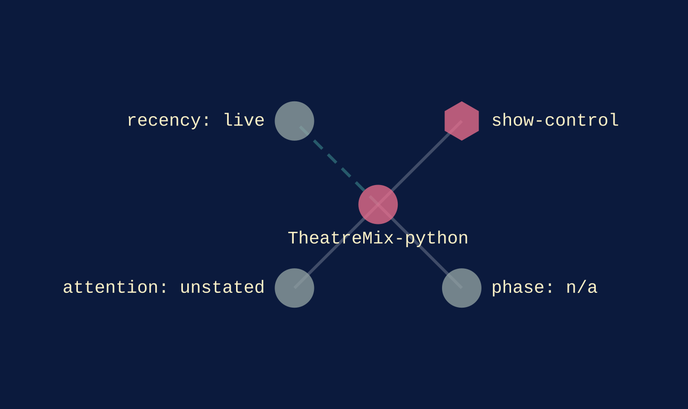{ loading=lazy }](TheatreMix-python.md#showgraph-estate)

<figcaption markdown="span">[TheatreMix-python](TheatreMix-python.md#showgraph-estate)</figcaption>

</figure>

<figure class="qm-shot" markdown>

[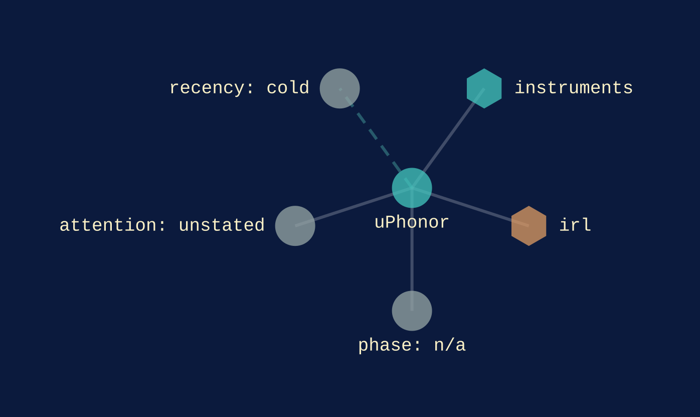{ loading=lazy }](uPhonor.md#showgraph-estate)

<figcaption markdown="span">[uPhonor](uPhonor.md#showgraph-estate)</figcaption>

</figure>

<figure class="qm-shot" markdown>

[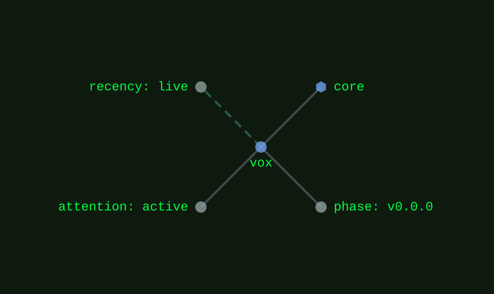{ loading=lazy }](vox.md#showgraph-estate)

<figcaption markdown="span">[vox](vox.md#showgraph-estate)</figcaption>

</figure>

<figure class="qm-shot" markdown>

[{ loading=lazy }](waveofhormuz.md#showgraph-estate)

<figcaption markdown="span">[waveofhormuz](waveofhormuz.md#showgraph-estate)</figcaption>

</figure>

<figure class="qm-shot" markdown>

[{ loading=lazy }](wolf.md#showgraph-estate)

<figcaption markdown="span">[wolf](wolf.md#showgraph-estate)</figcaption>

</figure>

<figure class="qm-shot" markdown>

[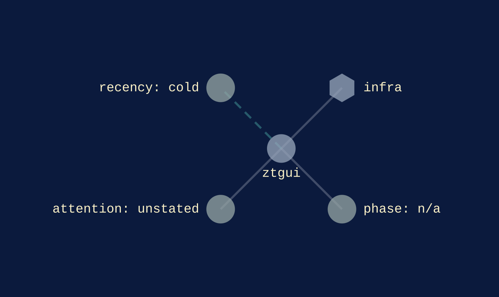{ loading=lazy }](ztgui.md#showgraph-estate)

<figcaption markdown="span">[ztgui](ztgui.md#showgraph-estate)</figcaption>

</figure>

#### Every project's system { #every-projects-system }

<figure class="qm-shot" markdown>

[{ loading=lazy }](moat.md#showgraph-system)

<figcaption markdown="span">[moat](moat.md#showgraph-system)</figcaption>

</figure>

#### Every family { #every-family }

<figure class="qm-shot" markdown>

[{ loading=lazy }](../families/commons.md#showgraph-estate)

<figcaption markdown="span">[commons](../families/commons.md#showgraph-estate)</figcaption>

</figure>

<figure class="qm-shot" markdown>

[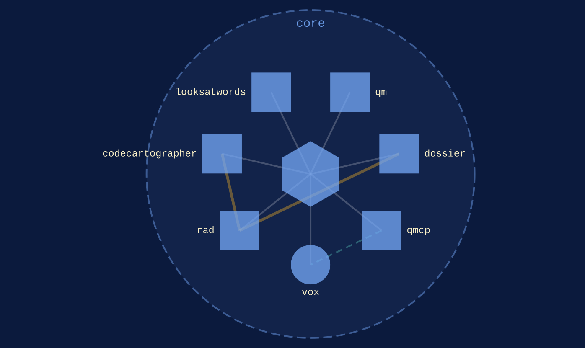{ loading=lazy }](../families/core.md#showgraph-estate)

<figcaption markdown="span">[core](../families/core.md#showgraph-estate)</figcaption>

</figure>

<figure class="qm-shot" markdown>

[{ loading=lazy }](../families/games.md#showgraph-estate)

<figcaption markdown="span">[games](../families/games.md#showgraph-estate)</figcaption>

</figure>

<figure class="qm-shot" markdown>

[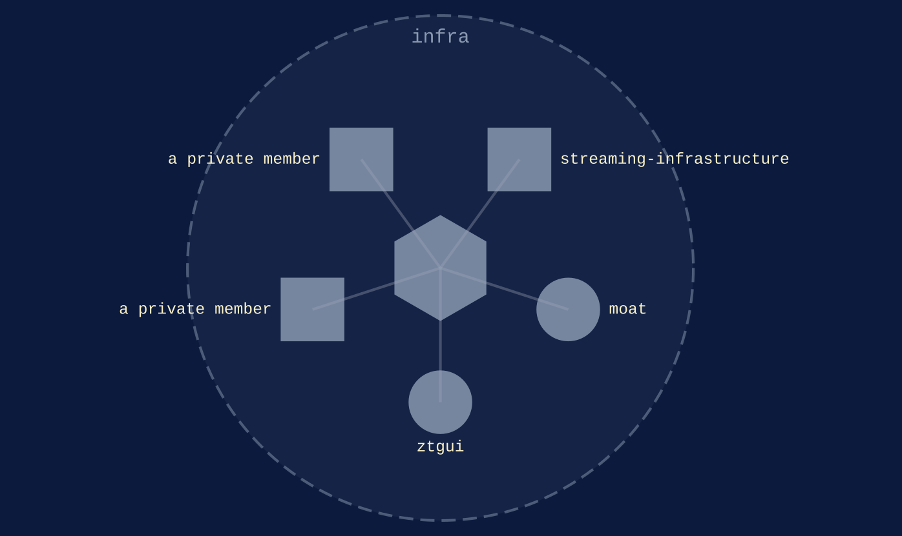{ loading=lazy }](../families/infra.md#showgraph-estate)

<figcaption markdown="span">[infra](../families/infra.md#showgraph-estate)</figcaption>

</figure>

<figure class="qm-shot" markdown>

[{ loading=lazy }](../families/instruments.md#showgraph-estate)

<figcaption markdown="span">[instruments](../families/instruments.md#showgraph-estate)</figcaption>

</figure>

<figure class="qm-shot" markdown>

[{ loading=lazy }](../families/irl.md#showgraph-estate)

<figcaption markdown="span">[irl](../families/irl.md#showgraph-estate)</figcaption>

</figure>

<figure class="qm-shot" markdown>

[{ loading=lazy }](../families/performer-display.md#showgraph-estate)

<figcaption markdown="span">[performer-display](../families/performer-display.md#showgraph-estate)</figcaption>

</figure>

<figure class="qm-shot" markdown>

[{ loading=lazy }](../families/performing.md#showgraph-estate)

<figcaption markdown="span">[performing](../families/performing.md#showgraph-estate)</figcaption>

</figure>

<figure class="qm-shot" markdown>

[{ loading=lazy }](../families/show-control.md#showgraph-estate)

<figcaption markdown="span">[show-control](../families/show-control.md#showgraph-estate)</figcaption>

</figure>

</section>

Generated by `uv run qm cookbook docs/families --site --write` from `families.json`, the inventory, `ci/showcase.yaml` and the show documents `uv run codecarto show export` writes into `docs/show/`. The families are decided in the [family record](https://github.com/quaternionmedia/qm/blob/main/records/DRAFT-a-family-is-bordered-by-what-it-drives.md); edit the roster, the record or the showcase, not this page.
{ .qm-caption }
