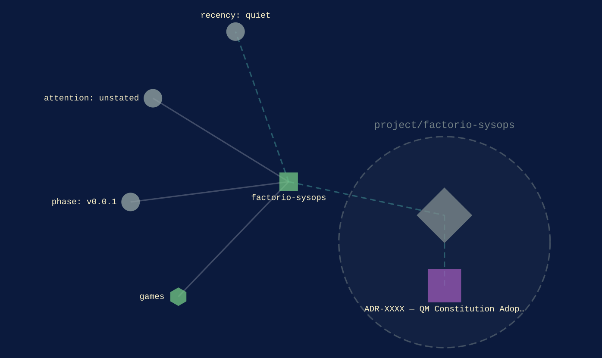
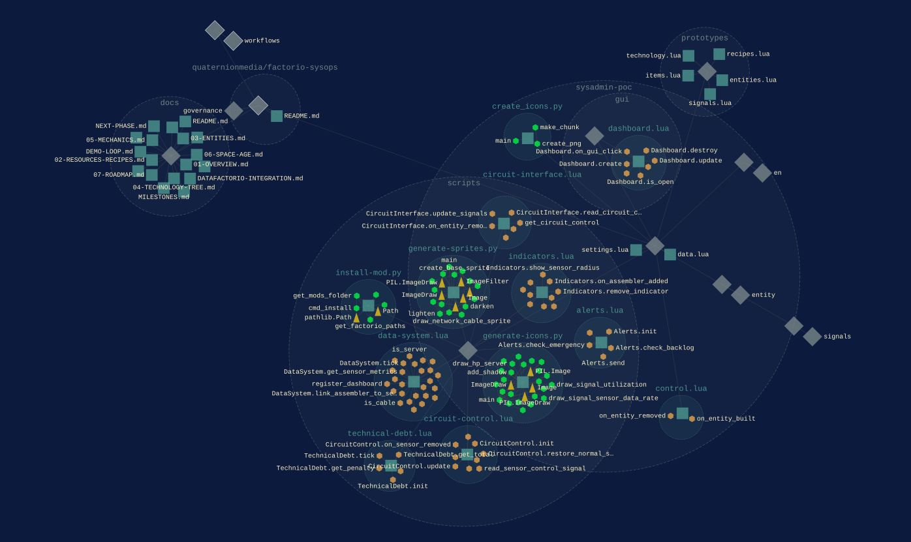

[games](../families/games.md)
{ .qm-eyebrow }

# factorio-sysops. { .qm-family-title .qm-f-games }

Factorio mod: IT Infrastructure addon (sensors, servers, dashboards, incidents, technical debt) -- monitor and automate your factory's IT layer

[`v0.0.1`](../usage/next-steps.md#the-project-phase-ladder) · Lua
{ .qm-caption }

[factorio-sysops on GitHub](https://github.com/quaternionmedia/factorio-sysops){ .md-button .md-button--primary }

No pictures are listed for factorio-sysops yet. A project's own screenshots are picked in the corpus's `ci/showcase.yaml`.
{ .qm-caption }

<section class="qm-section" markdown>

what it looks like
{ .qm-eyebrow }

## Showcase

the graphs codecarto draws
{ .qm-eyebrow }

### Showgraph

<figure class="qm-shot" markdown>

<figcaption><strong>Where it sits.</strong> Its families, its phase, its records and the seams it is on.</figcaption>

</figure>

<figure class="qm-shot" markdown>

<figcaption><strong>Its code.</strong> Its default branch, by directory and file.</figcaption>

</figure>

**Its system:** not drawn. factorio-sysops's system view is composed from a clone of it, and this export read none.
{ .qm-caption }

Drawn by codecartographer at `e430930` from the corpus at `ba587c3` and factorio-sysops's default branch at `da1e1d0`, on 2026-10-27. [The show document](../show/project/factorio-sysops/show.json) holds each graph as drawn.
{ .qm-caption }

</section>

Generated by `uv run qm cookbook docs/families --site --write` from `families.json`, the inventory, `ci/showcase.yaml` and the show documents `uv run codecarto show export` writes into `docs/show/`. The families are decided in the [family record](https://github.com/quaternionmedia/qm/blob/main/records/DRAFT-a-family-is-bordered-by-what-it-drives.md); edit the roster, the record or the showcase, not this page.
{ .qm-caption }
