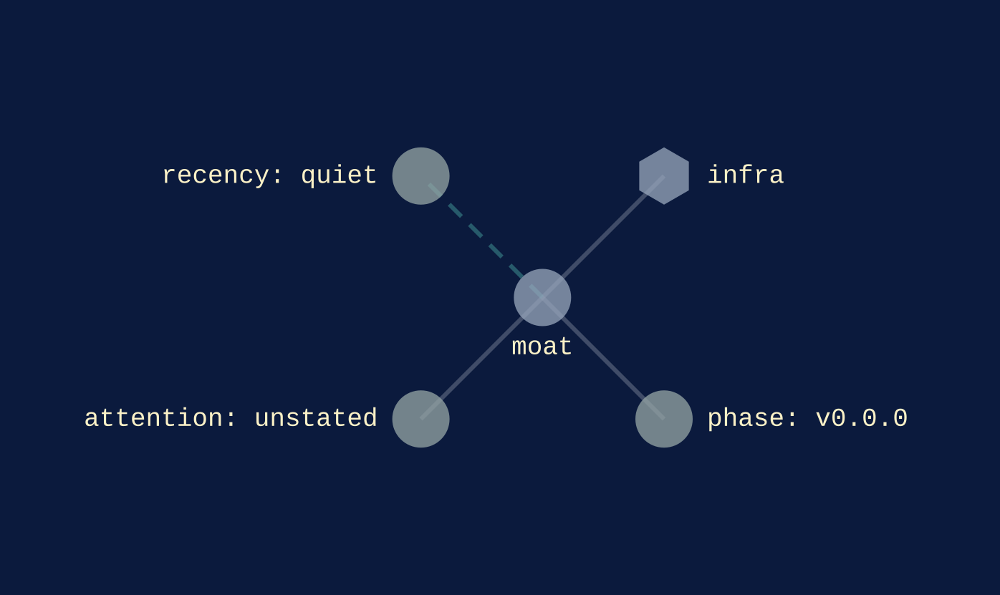
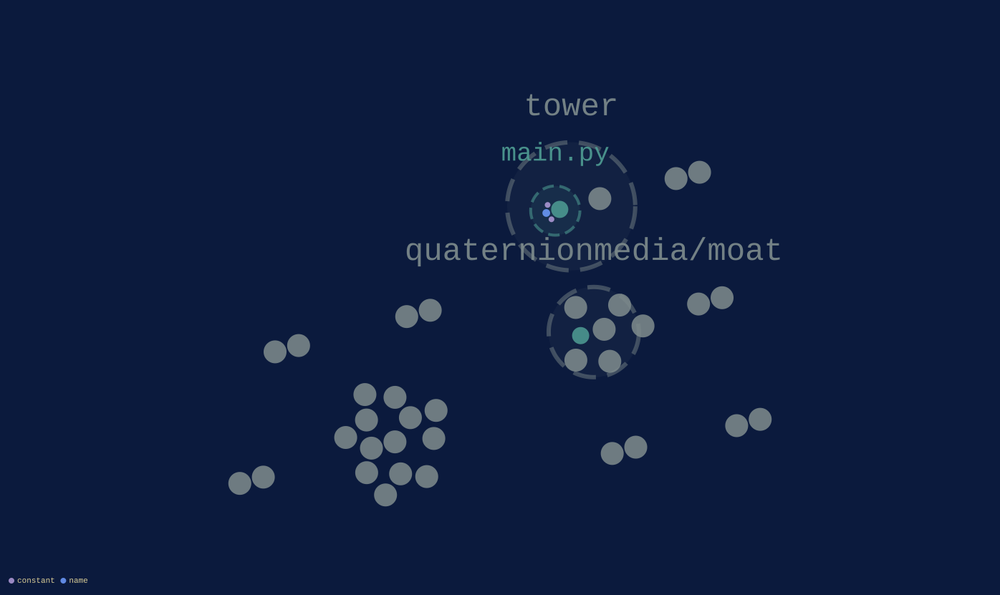
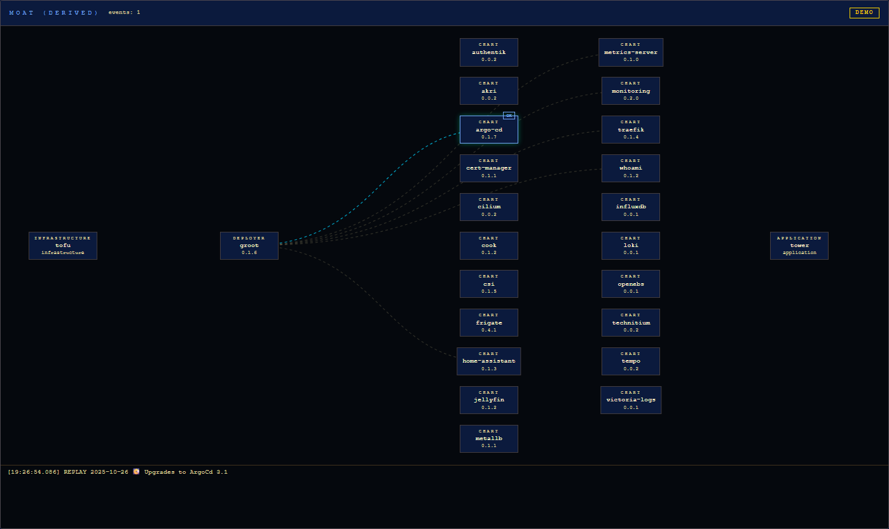

[infra](../families/infra.md)
{ .qm-eyebrow }

# moat. { .qm-family-title .qm-f-infra }

simple reverse proxy with Traefik

[`v0.0.0`](../usage/next-steps.md#the-project-phase-ladder) · HCL
{ .qm-caption }

[moat on GitHub](https://github.com/quaternionmedia/moat){ .md-button .md-button--primary }

No pictures are listed for moat yet. A project's own screenshots are picked in the corpus's `ci/showcase.yaml`.
{ .qm-caption }

<section class="qm-section" markdown>

what it looks like
{ .qm-eyebrow }

## Showcase

the graphs codecarto draws
{ .qm-eyebrow }

### Showgraph

<figure class="qm-shot" id="showgraph-estate" markdown>

<figcaption markdown="span"><strong>Where it sits.</strong> Its families, its phase, its records and the seams it is on. [← midiphonor](midiphonor.md#showgraph-estate) · [every project's estate](codecartographer.md#every-projects-estate) · [otto →](otto.md#showgraph-estate)</figcaption>

</figure>

<figure class="qm-shot" id="showgraph-code" markdown>

<figcaption markdown="span"><strong>Its code.</strong> Its default branch, by directory, file, symbol and member. [← midiphonor](midiphonor.md#showgraph-code) · [every project's code](codecartographer.md#every-projects-code) · [otto →](otto.md#showgraph-code)</figcaption>

</figure>

<figure class="qm-shot" id="showgraph-system" markdown>

<figcaption><strong>Its system.</strong> The system its own declarations describe.</figcaption>

</figure>

Drawn by codecartographer at `ada6a1b` from the corpus at `6906aee` and moat's default branch at `16a595a`, on 2026-10-27. [The show document](../show/project/moat/show.json) holds each graph as drawn.
{ .qm-caption }

</section>

Generated by `uv run qm cookbook docs/families --site --write` from `families.json`, the inventory, `ci/showcase.yaml` and the show documents `uv run codecarto show export` writes into `docs/show/`. The families are decided in the [family record](https://github.com/quaternionmedia/qm/blob/main/records/DRAFT-a-family-is-bordered-by-what-it-drives.md); edit the roster, the record or the showcase, not this page.
{ .qm-caption }
