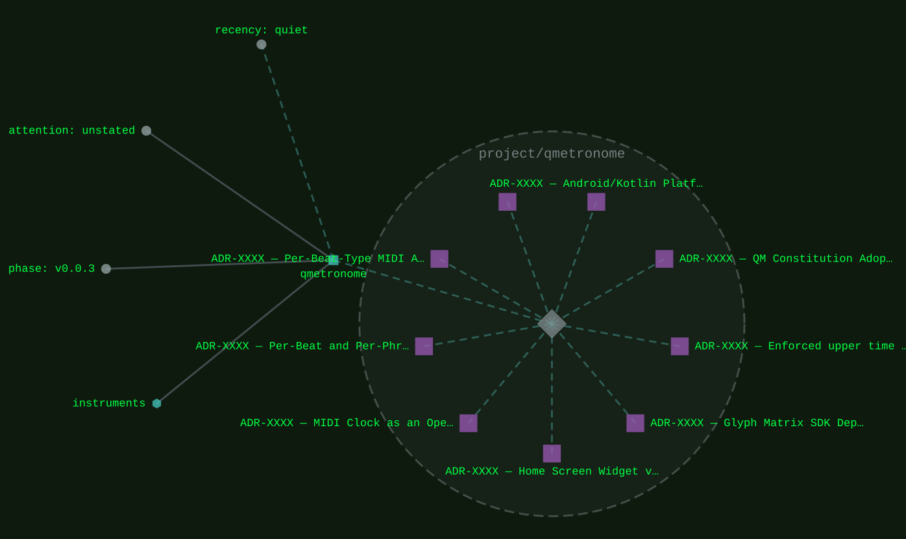
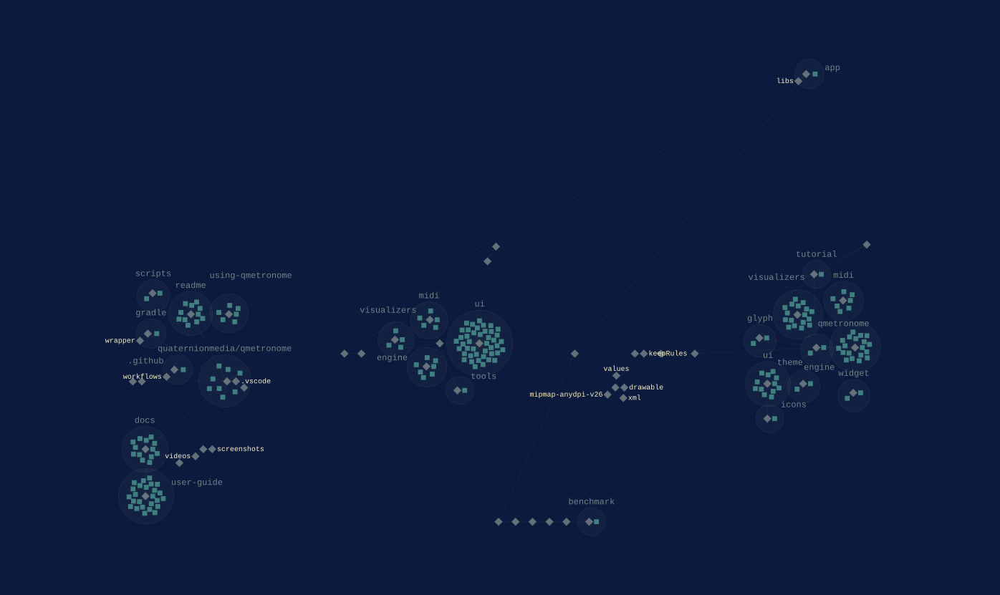

[instruments](../families/instruments.md) · within [performing](../families/performing.md)
{ .qm-eyebrow }

# qmetronome. { .qm-family-title .qm-f-instruments }

Metronome and tempo visualizer for Android 13+: tap tempo, set queues, MIDI clock sync, and the Nothing Phone Glyph Matrix

[`v0.0.3`](../usage/next-steps.md#the-project-phase-ladder) · Kotlin
{ .qm-caption }

[qmetronome on GitHub](https://github.com/quaternionmedia/qmetronome){ .md-button .md-button--primary }

<figure class="qm-hero-shot" markdown>

<figcaption><strong>qmetronome.</strong> The default visualizer running at 120 BPM in 4/4, with tap, play and hold.</figcaption>

</figure>

<section class="qm-section" markdown>

what it looks like
{ .qm-eyebrow }

## Showcase

<figure class="qm-shot" markdown>

<figcaption>The settings, from tempo and bars down through the timing offsets and the layout.</figcaption>

</figure>

<figure class="qm-shot" markdown>

<figcaption>Beat overrides, giving one beat its own MIDI action in any phrase and bar.</figcaption>

</figure>

the graphs codecarto draws
{ .qm-eyebrow }

### Showgraph

<figure class="qm-shot" markdown>

<figcaption><strong>Where it sits.</strong> Its families, its phase, its records and the seams it is on.</figcaption>

</figure>

<figure class="qm-shot" markdown>

<figcaption><strong>Its code.</strong> Its default branch, by directory and file.</figcaption>

</figure>

**Its system:** not drawn. qmetronome's system view is composed from a clone of it, and this export read none.
{ .qm-caption }

Drawn by codecartographer at `0c64e94` from the corpus at `3b94882` and qmetronome's default branch at `1abf5e9`, on 2026-10-26. [The show document](../show/project/qmetronome/show.json) holds each graph as drawn.
{ .qm-caption }

</section>

Generated by `uv run qm cookbook docs/families --site --write` from `families.json`, the inventory, `ci/showcase.yaml` and the show documents `uv run codecarto show export` writes into `docs/show/`. The families are decided in the [family record](https://github.com/quaternionmedia/qm/blob/main/records/DRAFT-a-family-is-bordered-by-what-it-drives.md); edit the roster, the record or the showcase, not this page.
{ .qm-caption }
