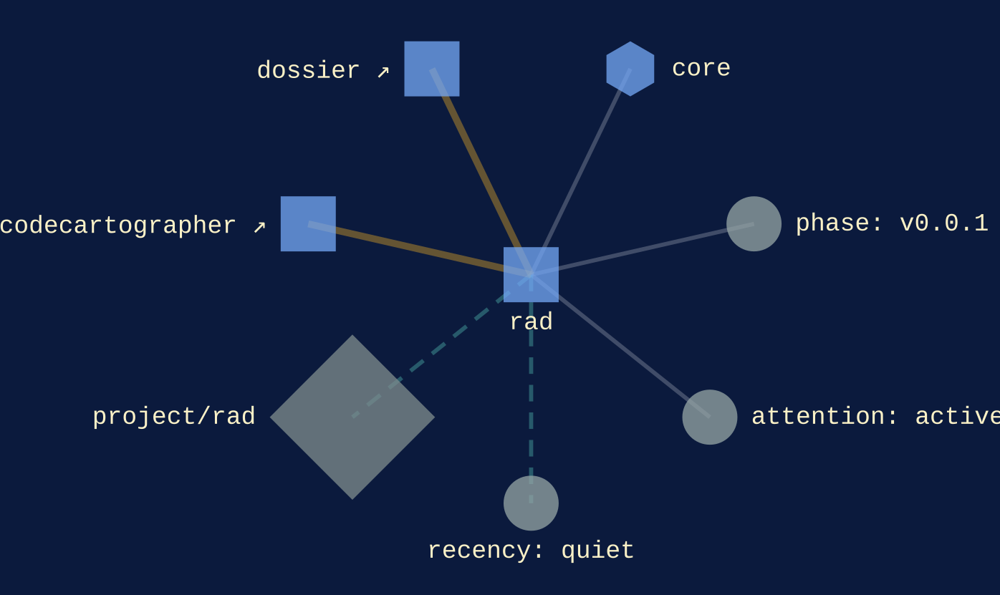
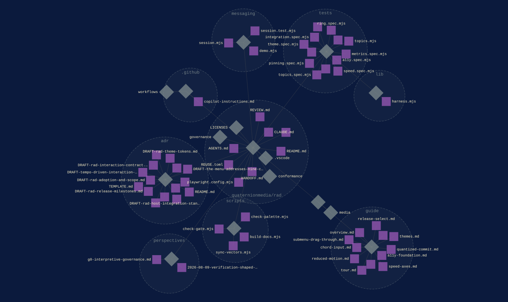

[core](../families/core.md)
{ .qm-eyebrow }

# rad. { .qm-family-title .qm-f-core }

QM's default radial menu: an interaction contract, conformance vectors and a single-file web reference

[`v0.0.1`](../usage/next-steps.md#the-project-phase-ladder) · JavaScript
{ .qm-caption }

[rad on GitHub](https://github.com/quaternionmedia/rad){ .md-button .md-button--primary }

<figure class="qm-hero-shot" markdown>

<figcaption><strong>rad.</strong> The radial menu's demo, the estate drawn as a graph under its controls.</figcaption>

</figure>

<figure class="qm-shot" markdown>

<figcaption>The demo after chord input, with its latency readouts filled in.</figcaption>

</figure>

<section class="qm-section" markdown>

the graphs codecarto draws
{ .qm-eyebrow }

## Showgraph

<figure class="qm-shot" markdown>

<figcaption><strong>Where it sits.</strong> Its families, its phase, its records and the seams it is on.</figcaption>

</figure>

<figure class="qm-shot" markdown>

<figcaption><strong>Its code.</strong> Its default branch, by directory and file.</figcaption>

</figure>

**Its system:** not drawn. rad declares no system this window reads: no Helm chart, ArgoCD Application, Terraform or Dockerfile.
{ .qm-caption }

Drawn by codecartographer at `8b1ab65` from the corpus at `2c4cb11` and rad's default branch at `3e8794f`, on 2026-10-26. [The show document](../show/project/rad/show.json) holds each graph as drawn.
{ .qm-caption }

</section>

Generated by `uv run qm cookbook docs/families --site --write` from `families.json`, the inventory, `ci/showcase.yaml` and the show documents `uv run codecarto show export` writes into `docs/show/`. The families are decided in the [family record](https://github.com/quaternionmedia/qm/blob/main/records/DRAFT-a-family-is-bordered-by-what-it-drives.md); edit the roster, the record or the showcase, not this page.
{ .qm-caption }
