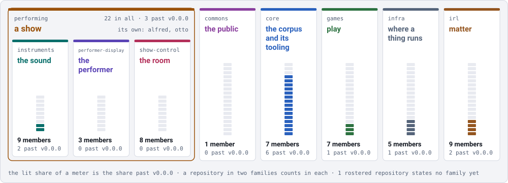

# Cookbook — the families

One page per family, generated from `families.json` and the clones on this disk. The families themselves are decided in `records/DRAFT-a-family-is-bordered-by-what-it-drives.md`; this is the onboarding view of them.

A family within another is listed under it, and its members count toward both. A repository in two families counts in each.

| family | within | drives | members | governed |
|---|---|---|---|---|
| [`commons`](./commons.md) | — | the public — open information a community reads and adds to: maps, records, public data | 1 | 0 |
| [`core`](./core.md) | — | the corpus and its tooling — governance, the archive, the deltas, the maps, the language data | 7 | 6 |
| [`games`](./games.md) | — | play — a game somebody plays: its rules, its world, its loop, and the server it is played on | 7 | 1 |
| [`infra`](./infra.md) | — | where a thing runs, and how it is reached — ingress, identity, storage, DNS, observability, the network path | 5 | 1 |
| [`irl`](./irl.md) | — | matter — a thing somebody builds, holds or installs: parts, boards, enclosures, and the firmware that makes one work | 9 | 2 |
| [`performing`](./performing.md) | — | a show — what an audience sees and hears, and the video made before and after it | 21 | 3 |
| [`instruments`](./instruments.md) | `performing` | the sound — looping, synthesis, tempo, remote control surfaces | 9 | 2 |
| [`performer-display`](./performer-display.md) | `performing` | the performer — what a player reads while playing | 3 | 0 |
| [`show-control`](./show-control.md) | `performing` | the room — cues, lighting, sound and video playback, audio transport | 8 | 0 |

`1` rostered repositories claim no family. That is *unstated*, not *none* — nobody has answered the question for them, and a page that listed them as unfamilied would be inventing an answer.

*Generated 2026-10-24.*
