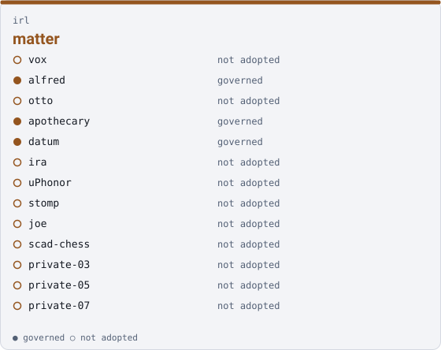

# Cookbook — the `irl` family

**This page is generated.** Every figure comes from `families.json` and from the clones on this disk, and `uv run qm cookbook --check` fails the build when it stops being true. Do not edit it; edit the roster or the record and regenerate.

**Drives** matter, and the record of its making — a thing somebody builds, holds or installs: parts, boards, enclosures, the firmware that makes one work, and what a camera and a mic keep of the work as it is done



## Who is in it

| member | governed |
|---|---|
| `vox` | no |
| `alfred` | yes |
| `otto` | no |
| `apothecary` | yes |
| `datum` | yes |
| `ira` | no |
| `uPhonor` | no |
| `stomp` | no |
| `joe` | no |
| `scad-chess` | no |
| `private-03` | no |
| `private-05` | no |
| `private-07` | no |

Also in another family, because each drives more than one thing:

- `vox` — [`core`](./core.md)
- `alfred` — [`performing`](./performing.md)
- `otto` — [`performing`](./performing.md)
- `ira` — [`show-control`](./show-control.md)
- `uPhonor` — [`instruments`](./instruments.md)
- `stomp` — [`instruments`](./instruments.md)
- `joe` — [`performer-display`](./performer-display.md)

## Starting here

3 of 13 members carry governance, and each is a governed entry point: `alfred`, `apothecary`, `datum`. Begin in any of them:

```sh
cd <member>               # one of those named above
uv run qm cowork          # or read AGENTS.md, if this repo has no CLI
```

A governed member is one with a `project/<name>` branch in the corpus. Its records live there, not in the repository itself.

## What this page deliberately does not carry

**Anything machine-scoped.** Which branch a clone is on, how many uncommitted files it has, whether it is on this disk at all — none of that is here, because this page is committed and those facts differ per machine and per keystroke. A committed document carrying them drifts every time somebody edits a file, and a check that fails hourly is one people learn to rerun rather than read.

`ci/workspace.yaml` and `status/inventory.yaml` make the same split for the same reason, with the machine-scoped half in an uncommitted companion. Run `uv run qm cookbook` with no argument to see this family's state on the disk you are actually sitting at.

## What this page cannot tell you

Whether any of it works. It reports a claim — the family, stated by a person in the roster — and it does not run a member. A family name is never a statement that anybody is working on it.

*Generated 2026-11-05 from `families.json`.*
