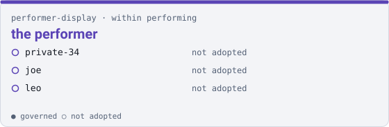

# Cookbook — the `performer-display` family

**This page is generated.** Every figure comes from `families.json` and from the clones on this disk, and `uv run qm cookbook --check` fails the build when it stops being true. Do not edit it; edit the roster or the record and regenerate.

**Drives** the performer — what a player reads while playing

**Within** [`performing`](./performing.md): a member of this family is a member of `performing` too, without claiming it.



## Who is in it

| member | governed |
|---|---|
| `loopwall` | yes |
| `joe` | no |
| `leo` | no |

Also in another family, because each drives more than one thing:

- `loopwall` — [`instruments`](./instruments.md)

## Starting here

1 of 3 members carry governance, so this family has a governed entry point. Begin in `loopwall`:

```sh
cd loopwall
uv run qm cowork          # or read AGENTS.md, if this repo has no CLI
```

A governed member is one with a `project/<name>` branch in the corpus. Its records live there, not in the repository itself.

## What this page deliberately does not carry

**Anything machine-scoped.** Which branch a clone is on, how many uncommitted files it has, whether it is on this disk at all — none of that is here, because this page is committed and those facts differ per machine and per keystroke. A committed document carrying them drifts every time somebody edits a file, and a check that fails hourly is one people learn to rerun rather than read.

`ci/workspace.yaml` and `status/inventory.yaml` make the same split for the same reason, with the machine-scoped half in an uncommitted companion. Run `uv run qm cookbook` with no argument to see this family's state on the disk you are actually sitting at.

## What this page cannot tell you

Whether any of it works. It reports a claim — the family, stated by a person in the roster — and it does not run a member. A family name is never a statement that anybody is working on it.

*Generated 2026-10-31 from `families.json`.*
