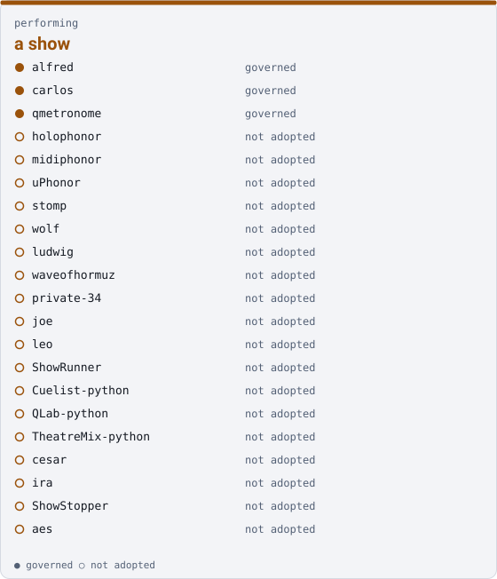

# Cookbook — the `performing` family

**This page is generated.** Every figure comes from `families.json` and from the clones on this disk, and `uv run qm cookbook --check` fails the build when it stops being true. Do not edit it; edit the roster or the record and regenerate.

**Drives** a show — what an audience sees and hears, and the video made before and after it



## Who is in it

| member | governed |
|---|---|
| `alfred` | yes |
| `carlos` | yes |
| `qmetronome` | yes |
| `holophonor` | no |
| `midiphonor` | no |
| `uPhonor` | no |
| `stomp` | no |
| `wolf` | no |
| `ludwig` | no |
| `waveofhormuz` | no |
| `joe` | no |
| `leo` | no |
| `ShowRunner` | no |
| `Cuelist-python` | no |
| `QLab-python` | no |
| `TheatreMix-python` | no |
| `cesar` | no |
| `ira` | no |
| `ShowStopper` | no |
| `aes` | no |

Also in another family, because each drives more than one thing:

- `uPhonor` — [`irl`](./irl.md)
- `stomp` — [`irl`](./irl.md)
- `ira` — [`irl`](./irl.md)

## The families within it

Everyone in these is in this family as well, and is in the table above.

| family | drives | members | governed |
|---|---|---|---|
| [`instruments`](./instruments.md) | the sound — looping, synthesis, tempo, remote control surfaces | 9 | 2 |
| [`performer-display`](./performer-display.md) | the performer — what a player reads while playing | 2 | 0 |
| [`show-control`](./show-control.md) | the room — cues, lighting, sound and video playback, audio transport | 8 | 0 |

## Starting here

3 of 20 members carry governance, so this family has a governed entry point. Begin in `alfred`:

```sh
cd alfred
uv run qm cowork          # or read AGENTS.md, if this repo has no CLI
```

A governed member is one with a `project/<name>` branch in the corpus. Its records live there, not in the repository itself.

## What this page deliberately does not carry

**Anything machine-scoped.** Which branch a clone is on, how many uncommitted files it has, whether it is on this disk at all — none of that is here, because this page is committed and those facts differ per machine and per keystroke. A committed document carrying them drifts every time somebody edits a file, and a check that fails hourly is one people learn to rerun rather than read.

`ci/workspace.yaml` and `status/inventory.yaml` make the same split for the same reason, with the machine-scoped half in an uncommitted companion. Run `uv run qm cookbook` with no argument to see this family's state on the disk you are actually sitting at.

## What this page cannot tell you

Whether any of it works. It reports a claim — the family, stated by a person in the roster — and it does not run a member. A family name is never a statement that anybody is working on it.

*Generated 2026-10-20 from `families.json`.*
